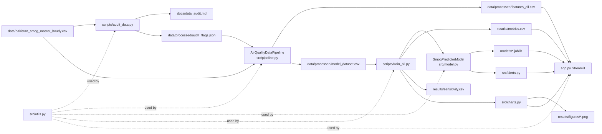

# Design Document: Dhund-Khabar AI (دُھند خبر)

## Overview

Dhund-Khabar AI forecasts PM2.5 and US AQI for Peshawar and Lahore at 24, 48, and 72 hour horizons from the real hourly file `data/pakistan_smog_master_hourly.csv` (75,456 rows, 26 columns, 37,728 hourly rows per city from 2022-08-01 00:00 to 2026-11-19 23:00). The project is a Python 3.14.3 student codebase with exactly two classes and a Streamlit dashboard.

The design follows the seven delivery phases from Requirement 4:

| Phase | Output | Main files |
|---|---|---|
| 1 Data audit | Printed audit, `docs/data_audit.md`, proposed Gap_Strategy | `scripts/audit_data.py`, `src/utils.py` |
| 2 Pipeline | Feature and target frames in `data/processed/` | `src/pipeline.py` |
| 3 Model and training | `models/*.joblib`, `results/metrics.csv`, `results/sensitivity.csv` | `src/model.py`, `src/alerts.py`, `scripts/train_all.py` |
| 4 Charts | `results/figures/*.png` | `src/charts.py`, `scripts/train_all.py --figures-only` |
| 5 Dashboard | Stitch design, then `app.py` | `app.py` |
| 6 Tests | Passing pytest run | `tests/` |
| 7 Documentation | `README.md` | `README.md`, `requirements.txt` |

Every phase ends with a Phase_Checkpoint (Requirement 4.2–4.3): the Developer stops, shows the real console and file outputs, and waits for "continue". Phase 1's checkpoint also waits for Gap_Strategy approval (4.4). Phase 5 has two checkpoints: Stitch design approval before any `app.py` code (15.2), and the finished dashboard. The final deliverable (Requirement 20) follows the Phase 7 checkpoint.

Key design decisions recorded here:

1. **Per-horizon embargo** (Requirements 9.3, 9.5, 18.6). A training row at time t with horizon h is kept only if t + h < 2025-01-01 00:00. Training feature rows end at 2024-12-31 23:00 minus h hours, every training label timestamp is before 2025-01-01, and no Test_Period value is ever used as a training label.
2. **us_aqi forecast features** include us_aqi at time t plus us_aqi_lag_1 and us_aqi_lag_24, because all three are known at prediction time. pm2_5 target models never see us_aqi, its lags, or aqi_category.
3. **Inversion proxy** is `inversion_proxy = relative_humidity_2m / 100 - temperature_2m / 40` (dimensionless).
4. **AQI tiers** use decimal boundaries that include the upper bound (`lower < aqi <= upper`), so 50 is Good and 50.4 is Moderate. The industrial curfew uses the same boundary: it applies whenever the tier is Very Unhealthy or Hazardous (Emergency), that is AQI > 200, so 200.5 gets a curfew and 200 does not.
5. **Property tests** use seeded NumPy generators inside pytest, because Hypothesis is not in the allowed library list (Requirement 1.2).

## Architecture



Dependency rules, which avoid circular imports:

- `src/utils.py` imports only numpy, pandas, and scikit-learn metrics. It holds constants and pure helper functions.
- `src/alerts.py` imports numpy only. It holds the EPA tier table and advisory functions.
- `src/pipeline.py` imports `utils`.
- `src/model.py` imports `utils` and `alerts`.
- `src/charts.py` imports `alerts` (for tier bands) and `utils`.
- `scripts/*.py` and `app.py` import from `src`. Scripts add the project root to `sys.path` so they run as `python scripts/train_all.py` from the project root.

### File layout

```
dhund khabar ai/
├── app.py                         # Streamlit dashboard (plain functions)
├── requirements.txt
├── README.md
├── data/
│   ├── pakistan_smog_master_hourly.csv
│   ├── (other existing CSVs, not used by code)
│   └── processed/
│       ├── audit_flags.json       # written by audit_data.py
│       ├── features_all.csv       # all rows, features, no targets
│       └── model_dataset.csv      # features + targets, NaN targets dropped
├── docs/
│   └── data_audit.md
├── models/
│   └── {city}_{target}_h{h}_{mode}_{model_type}.joblib
├── results/
│   ├── metrics.csv
│   ├── sensitivity.csv
│   └── figures/*.png
├── scripts/
│   ├── audit_data.py
│   └── train_all.py
├── src/
│   ├── __init__.py
│   ├── pipeline.py                # class AirQualityDataPipeline
│   ├── model.py                   # class SmogPredictorModel
│   ├── alerts.py
│   ├── charts.py
│   └── utils.py
└── tests/
    ├── conftest.py
    ├── test_pipeline.py
    ├── test_model.py
    ├── test_alerts.py
    └── test_utils.py
```

`scripts/train_all.py` is the Training_Script named in the glossary. Figure generation lives inside it behind a `--figures-only` flag, so the README command list in Requirement 19.8 stays complete. `results/sensitivity.csv` stores the Requirement 13.9–13.10 measurements so the README can quote real numbers.

## Components and Interfaces

### src/utils.py (plain functions and constants)

```python
MASTER_PATH: Path = Path("data/pakistan_smog_master_hourly.csv")
PROCESSED_DIR: Path = Path("data/processed")
MODELS_DIR: Path = Path("models")
RESULTS_DIR: Path = Path("results")
FIGURES_DIR: Path = RESULTS_DIR / "figures"

REQUIRED_COLUMNS: list[str] = [
    "city", "latitude", "longitude", "time", "pm10", "pm2_5", "carbon_monoxide",
    "nitrogen_dioxide", "sulphur_dioxide", "ozone", "dust", "us_aqi",
    "temperature_2m", "relative_humidity_2m", "surface_pressure", "wind_speed_10m",
    "wind_direction_10m", "precipitation", "datetime", "year", "month", "day",
    "hour", "day_of_week", "is_weekend", "aqi_category",
]
POLLUTANT_COLUMNS: list[str] = ["pm10", "pm2_5", "carbon_monoxide", "nitrogen_dioxide",
                                "sulphur_dioxide", "ozone", "dust"]
WEATHER_COLUMNS: list[str] = ["temperature_2m", "relative_humidity_2m", "surface_pressure",
                              "wind_speed_10m", "wind_direction_10m", "precipitation"]
CITIES: list[str] = ["Peshawar", "Lahore"]
HORIZONS: list[int] = [24, 48, 72]
TARGET_TYPES: list[str] = ["pm2_5", "us_aqi"]
SPLIT_DATE: str = "2025-01-01"
WINTER_MONTHS: list[int] = [11, 12, 1, 2]
RANDOM_STATE: int = 42
STAGNATION_WIND_KMH: float = 5.0
SLIDER_RANGES: dict[str, tuple[float, float]] = {
    "wind_speed_10m": (0.0, 30.0),
    "temperature_2m": (5.0, 35.0),
    "relative_humidity_2m": (20.0, 100.0),
}
INVERSION_LEVELS: list[tuple[float, str]] = [(0.50, "Strong"), (0.25, "Moderate")]  # else "Weak"
```

| Function | Signature | Purpose |
|---|---|---|
| `mae` | `(y_true: np.ndarray, y_pred: np.ndarray) -> float` | `np.mean(np.abs(y_true - y_pred))` |
| `rmse` | `(y_true: np.ndarray, y_pred: np.ndarray) -> float` | `np.sqrt(np.mean((y_true - y_pred) ** 2))` |
| `r2` | `(y_true: np.ndarray, y_pred: np.ndarray) -> float` | wraps `sklearn.metrics.r2_score` |
| `inversion_proxy` | `(temperature_2m: np.ndarray \| float, relative_humidity_2m: np.ndarray \| float) -> np.ndarray \| float` | exact formula below |
| `inversion_level` | `(proxy: float) -> str` | "Strong" if ≥ 0.50, "Moderate" if ≥ 0.25, else "Weak" |
| `stagnation_flag` | `(wind_speed_10m: np.ndarray \| float) -> np.ndarray \| int` | `1` where wind < 5 km/h |
| `persistence_forecast` | `(df: pd.DataFrame, target_type: str) -> np.ndarray` | returns `df[target_type]` at time t as the prediction for t + h |
| `tier_accuracy` | `(y_true_aqi: np.ndarray, y_pred_aqi: np.ndarray) -> float` | share of rows with equal tier index |
| `unhealthy_precision_recall` | `(y_true_aqi: np.ndarray, y_pred_aqi: np.ndarray) -> tuple[float, float]` | event = AQI > 150; NaN when a denominator is 0 |
| `pm25_sub_index` | `(pm25_24h: np.ndarray, table: str) -> np.ndarray` | EPA PM2.5 sub-index, table `"2024"` or `"2012"` |
| `clamp_slider_default` | `(value: float, low: float, high: float) -> tuple[float, bool]` | `(clipped, was_clamped)` |
| `build_scenario_row` | `(base_row: pd.Series, wind: float, temp: float, humidity: float, feature_cols: list[str]) -> pd.DataFrame` | one-row frame with slider values and recomputed stagnation_flag and inversion_proxy |
| `model_path` | `(city: str, target: str, horizon: int, mode: str, model_type: str) -> Path` | `models/{city.lower()}_{target}_h{h}_{mode}_{model_type}.joblib` |
| `xgboost_available` | `() -> bool` | guarded `importlib.util.find_spec("xgboost")` |
| `ensure_dir` | `(path: Path) -> Path` | `mkdir(parents=True, exist_ok=True)` |

**Inversion proxy formula (exact).**

```
inversion_proxy = relative_humidity_2m / 100 - temperature_2m / 40
```

- Units: temperature_2m in °C, relative_humidity_2m in %. The result has no unit.
- Partial derivatives are constant: −1/40 per °C and +1/100 per % RH. The proxy therefore strictly increases as temperature_2m decreases and strictly increases as relative_humidity_2m increases (Requirement 8.8).
- Example values: cold humid winter morning (8 °C, 90%) gives 0.70 (Strong). Mild day (20 °C, 60%) gives 0.10 (Weak). Hot dry afternoon (38 °C, 30%) gives −0.65 (Weak).
- The proxy is a heuristic for "cold, moist, near-surface air that favours trapped smog". It is not a measured temperature inversion, and the dashboard card says so. The 0.25 and 0.50 thresholds are fixed heuristics, stated in the README.
- The same `utils.inversion_proxy` function is used by the pipeline, the What-If scenario builder, and the dashboard card, so all three agree. The pipeline method docstring repeats the formula verbatim.

**EPA PM2.5 sub-index (audit only).** The audit computes the sub-index from the 24-hour trailing mean of pm2_5 with linear interpolation inside breakpoint rows, for two tables, and reports both mismatch rates so the student can see which table the data source follows:

| AQI | 2024 table (µg/m³) | 2012 table (µg/m³) |
|---|---|---|
| 0–50 | 0.0–9.0 | 0.0–12.0 |
| 51–100 | 9.1–35.4 | 12.1–35.4 |
| 101–150 | 35.5–55.4 | 35.5–55.4 |
| 151–200 | 55.5–125.4 | 55.5–150.4 |
| 201–300 | 125.5–225.4 | 150.5–250.4 |
| 301–500 | 225.5–325.4 | 250.5–500.4 |

Concentrations above the top row are capped at AQI 500 for the comparison.

### scripts/audit_data.py (Phase 1)

Plain functions, each returning a string block or a DataFrame that `main()` prints and appends to `docs/data_audit.md`:

| Function | Requirement |
|---|---|
| `audit_shape_and_dtypes(df) -> str` | 5.2 |
| `audit_date_range_per_city(df) -> pd.DataFrame` | 5.2 |
| `audit_missing_per_city(df) -> pd.DataFrame` | 5.3 |
| `audit_duplicate_timestamps(df) -> pd.DataFrame` | 5.4 |
| `audit_hourly_gaps(df) -> pd.DataFrame` (one row per gap: city, previous timestamp, next timestamp, step hours) | 5.5 |
| `audit_analysis_stats(df) -> pd.DataFrame` (describe() per city for Analysis_Columns) | 5.6 |
| `audit_impossible_values(df) -> pd.DataFrame` | 5.7 |
| `audit_datetime_vs_time(df) -> int` (`pd.to_datetime(time, format="%Y-%m-%dT%H:%M") != datetime`) | 5.8 |
| `audit_monthly_means(df) -> tuple[pd.DataFrame, str]` (pm2_5 and us_aqi per city per calendar month, plus a sentence on whether the top months are in {11, 12, 1, 2}) | 5.9 |
| `audit_aqi_subindex(df) -> str` (sample of 5,000 rows with both values present, `random_state=42`; reports mismatch rate where `round(sub_index) != round(us_aqi)`, mean absolute difference, and share where us_aqi > sub-index, for both tables) | 5.10, 5.11 |
| `audit_aqi_above_500(df) -> str` | 5.13 |
| `audit_forecast_like_rows(df) -> tuple[str, str \| None]` | 5.14 |
| `write_report(sections: list[str], path: Path) -> None` | 5.1 |

The report always includes two fixed statements: us_aqi may be the maximum of several pollutant sub-indices, so a PM2.5-only mismatch is expected (5.11), and the dataset provenance must be confirmed by the student because it may be modeled or reanalysis data (5.12).

**Forecast_Like_Row detection.** The audit applies two checks to each city and reports both:

1. Rows with a timestamp later than the audit run time cannot be observations. They are flagged.
2. For the last 180 days, the audit computes weekly statistics on pm2_5 and us_aqi: the share of hours equal to the previous hour, the median number of decimal places, and the lag-1 autocorrelation. A week is flagged when the repeated-value share exceeds three times the 2023 baseline or the decimal precision drops. The earliest flagged timestamp becomes the start of the Forecast_Like_Row range.

The audit writes `data/processed/audit_flags.json` as `{"forecast_like_start": "<YYYY-MM-DD HH:MM:SS>" | null, "method": "<text>", "audit_run": "<timestamp>"}`. The student reviews this range at the Phase 1 checkpoint. The pipeline reads the file if present and sets `is_forecast_like`. Rows are never removed for this reason (Requirement 2.4).

**Approved Gap_Strategy (approved by the user at the Phase 1 checkpoint on 2026-11-21, recorded in `docs/data_audit.md` under "Approved Gap_Strategy", applied in Phase 2 by `AirQualityDataPipeline._apply_gap_strategy`):**

1. Duplicate (city, datetime) pairs keep the first row, then each city is reindexed onto a complete hourly range from its first to last timestamp. Inserted rows get city, latitude, and longitude copied from the city and NaN elsewhere. This is a safety net; the audit found no duplicates or gaps, and the pipeline prints the rows dropped and inserted.
2. The Leading_Gap (leading missing pollutant and us_aqi hours per city) is not imputed. Those rows stay in the frame and are removed as warm-up rows by the split, because their lags, rolling values, or targets are NaN.
3. Interior pollutant and us_aqi gaps of up to 3 consecutive hours are forward-filled within each city only. Forward fill uses only past values, so it adds no lookahead. A gap longer than 3 hours stays entirely NaN; `groupby("city").ffill(limit=3)` alone would fill the first 3 hours of a longer gap, so the fill is masked to NaN runs of length ≤ 3 that follow a non-missing value in the same city. Affected rows drop out when a model needs those columns. Weather columns are left unchanged. The pipeline prints the number of filled values.
4. Negative pollutant concentrations (the audit found them in ozone and nitrogen_dioxide) are treated as model artifacts and clipped to 0 in every column of `POLLUTANT_COLUMNS`. Clipping runs before the forward fill, so the printed count of changed values is the number of negative values read from the file. us_aqi is not clipped.
5. us_aqi values above 500 are kept unchanged, map to Hazardous (Emergency), and are listed in the README limitations.
6. All rows are kept. No Forecast_Like_Rows were flagged, and `is_forecast_like` follows `audit_flags.json`. The rows after the master file's last-modified time (counted in the audit's "Forecast-like rows" section) are kept and mentioned in the README limitations.
7. aqi_category is kept as-is, including "Unknown". It is never a feature.

The printed Gap_Strategy counts are: duplicate rows dropped, rows inserted by reindexing, negative values clipped, and values forward-filled. Any later change to the strategy touches only `AirQualityDataPipeline._apply_gap_strategy`.

### src/pipeline.py: class AirQualityDataPipeline

```python
class AirQualityDataPipeline:
    """Load, validate, and feature-engineer the smog data, and build the time-based split."""

    DEFAULT_LAG_STEPS: tuple[int, ...] = (1, 3, 6, 12, 24, 48)
    US_AQI_LAG_STEPS: tuple[int, ...] = (1, 24)

    def __init__(self, flags_path: str | Path | None = PROCESSED_DIR / "audit_flags.json",
                 ffill_limit: int = 3) -> None: ...
    def load_data(self, filepath: str) -> pd.DataFrame: ...
    def filter_city(self, city_name: str) -> pd.DataFrame: ...
    def generate_time_features(self, df: pd.DataFrame) -> pd.DataFrame: ...
    def create_lag_and_rolling_features(self, df: pd.DataFrame,
                                        lag_steps: list[int] | None = None) -> pd.DataFrame: ...
    def create_targets(self, df: pd.DataFrame,
                       horizons: list[int] | None = None) -> pd.DataFrame: ...
    def prepare_train_test_split(self, df: pd.DataFrame, split_date: str = SPLIT_DATE,
                                 horizon: int | None = None
                                 ) -> tuple[pd.DataFrame, pd.DataFrame]: ...
    def get_feature_columns(self, target_type: str, mode: str) -> list[str]: ...
    def build_features(self, filepath: str) -> pd.DataFrame: ...
    def save_processed(self, df: pd.DataFrame, filename: str) -> Path: ...
    def _apply_gap_strategy(self, df: pd.DataFrame) -> pd.DataFrame: ...
```

`self.data` holds the last loaded frame so `filter_city` can work on it. `None` defaults replace mutable list defaults; `None` means the documented default list.

**load_data(filepath)**

1. `pd.read_csv(filepath)`.
2. Compare the header with `REQUIRED_COLUMNS`. If any are absent, raise `ValueError(f"Missing required columns: {', '.join(missing)}")` listing every missing column in file order (Requirement 6.3).
3. Parse `datetime` with `format="%Y-%m-%d %H:%M:%S"` (6.2).
4. `sort_values(["city", "datetime"], kind="mergesort").reset_index(drop=True)` (6.4).
5. `_apply_gap_strategy` (6.5), then add `is_forecast_like` (0/1) from `audit_flags.json` if present, else all 0.
6. Store in `self.data` and return a copy.

**filter_city(city_name)** returns `self.data[self.data["city"] == city_name].copy()`. If `self.data` is None it raises `RuntimeError("Call load_data first")`. An unknown city raises `ValueError(f"Unknown city '{city_name}'. Available cities: {sorted cities}")` (6.7).

**generate_time_features(df)** uses NumPy on `df["datetime"].dt.hour` and `.dt.month`:

- `hour_sin = np.sin(2*np.pi*hour/24)`, `hour_cos = np.cos(2*np.pi*hour/24)`
- `month_sin = np.sin(2*np.pi*month/12)`, `month_cos = np.cos(2*np.pi*month/12)`
- `is_weekend = (datetime.dt.dayofweek >= 5).astype(int)`. This overwrites the file's is_weekend so the value is derived from the parsed timestamp, not trusted from the string column.
- `is_winter = np.isin(month, WINTER_MONTHS).astype(int)`

**create_lag_and_rolling_features(df, lag_steps)** requires a frame sorted by city and datetime on a complete hourly grid (guaranteed by load_data; the method asserts sorting). All operations use `df.groupby("city", sort=False)[col]`, so no value crosses a city boundary (8.1).

| Feature | Definition |
|---|---|
| `pm2_5_lag_{k}`, k in lag_steps (default 1, 3, 6, 12, 24, 48) | `groupby(city).shift(k)` |
| `us_aqi_lag_1`, `us_aqi_lag_24` | `groupby(city).shift(k)` |
| `pm2_5_rolling_mean_24h` | `groupby(city).rolling(24, min_periods=24).mean()` |
| `pm2_5_rolling_mean_72h` | `rolling(72, min_periods=72).mean()` |
| `pm2_5_rolling_std_24h` | `rolling(24, min_periods=24).std()` (pandas default ddof=1) |
| `wind_speed_rolling_mean_6h` | `rolling(6, min_periods=6).mean()` on wind_speed_10m |
| `humidity_rolling_mean_6h` | same on relative_humidity_2m |
| `temperature_rolling_mean_6h` | same on temperature_2m |
| `pm2_5_change_24h` | `pm2_5 - pm2_5_lag_24` (computed from the city-grouped shift) |
| `stagnation_flag` | `utils.stagnation_flag(wind_speed_10m)`: 1 if < 5 km/h else 0 |
| `inversion_proxy` | `utils.inversion_proxy(temperature_2m, relative_humidity_2m)` |

pandas `rolling(w)` is trailing: the window at row t covers rows t−w+1 through t, so every rolling value uses only values at or before t (8.9). `min_periods=w` makes warm-up rows NaN rather than averaging a partial window. `rolling` results are re-aligned to the original index with `reset_index(level=0, drop=True)`.

**create_targets(df, horizons)** adds, for each h in [24, 48, 72], `pm2_5_t_plus_{h} = groupby(city)["pm2_5"].shift(-h)` and `us_aqi_t_plus_{h} = groupby(city)["us_aqi"].shift(-h)` (9.1). It then drops rows where any created target is NaN (9.2). Because the hourly grid is complete, a shift of h rows equals h hours; the method asserts that consecutive timestamps within each city differ by exactly 1 hour before shifting, and raises `ValueError` otherwise. Dropping all-horizon NaN targets removes the last 72 hours of each city and the Leading_Gap rows where us_aqi targets are NaN.

**prepare_train_test_split(df, split_date, horizon)**

1. `split_ts = pd.Timestamp(split_date)`.
2. `horizon=None` means the largest horizon found among `*_t_plus_{h}` columns (72), which is the conservative choice for a frame used for several horizons. The Training_Script always passes the explicit horizon, so each model keeps as many training rows as allowed.
3. Drop warm-up rows with NaN in any lag or rolling feature column (9.4).
4. Train mask: `datetime < split_ts` **and** `datetime + pd.Timedelta(hours=horizon) < split_ts` (the embargo).
5. Test mask: `datetime >= split_ts` (9.3).
6. `assert train["datetime"].max() < test["datetime"].min()` (9.5). A second assert checks `(train["datetime"] + Timedelta(hours=horizon)).max() < split_ts`.
7. Return `(train.copy(), test.copy())` (9.6).

**Embargo rationale and effect.** Without the embargo, a row at 2024-12-31 00:00 with h = 72 would carry the label pm2_5 at 2025-01-03 00:00, a Test_Period value. The model would then train on test-period labels, which is leakage at the boundary. With the embargo, the last training row is at `2025-01-01 00:00 − h − 1 hour`:

| Horizon | Last training feature row | Last training label timestamp | Rows dropped per city |
|---|---|---|---|
| 24 | 2024-12-30 23:00 | 2024-12-31 23:00 | 24 |
| 48 | 2024-12-29 23:00 | 2024-12-31 23:00 | 48 |
| 72 | 2024-12-28 23:00 | 2024-12-31 23:00 | 72 |

The training labels always end on 2024-12-31 23:00, and the test set starts at 2025-01-01 00:00. Requirements 9.3 and 18.6 state this rule directly: training feature rows end at 2024-12-31 23:00 minus h hours, and every training label timestamp is before 2025-01-01. Test rows near the start of 2025 use lag features from late 2024. That is correct, because those values are known at prediction time.

**get_feature_columns(target_type, mode)** validates arguments first: an invalid value raises `ValueError("target_type must be one of ['pm2_5', 'us_aqi']; mode must be one of ['forecast', 'simulation']")` with the bad value named (10.6).

| Group | Columns | pm2_5 forecast | us_aqi forecast | simulation (both targets) |
|---|---|---|---|---|
| Pollutants at t | pm2_5, pm10, carbon_monoxide, nitrogen_dioxide, sulphur_dioxide, ozone, dust | yes | yes | no |
| us_aqi family at t | us_aqi, us_aqi_lag_1, us_aqi_lag_24 | **no** | **yes** | no |
| pm2_5 lags | pm2_5_lag_1, _3, _6, _12, _24, _48 | yes | yes | no |
| pm2_5 rolling | pm2_5_rolling_mean_24h, pm2_5_rolling_mean_72h, pm2_5_rolling_std_24h, pm2_5_change_24h | yes | yes | only pm2_5_rolling_mean_24h |
| Weather at t | temperature_2m, relative_humidity_2m, surface_pressure, wind_speed_10m, wind_direction_10m, precipitation | yes | yes | yes |
| Weather rolling | wind_speed_rolling_mean_6h, humidity_rolling_mean_6h, temperature_rolling_mean_6h | yes | yes | no |
| Derived weather | stagnation_flag, inversion_proxy | yes | yes | yes |
| Time | hour_sin, hour_cos, month_sin, month_cos, is_weekend, is_winter | yes | yes | yes |

Never features: city, latitude, longitude (constant within a per-city model), time, datetime, year, month, day, hour, day_of_week (replaced by cyclical features), aqi_category, is_forecast_like, and all `*_t_plus_*` targets (10.5).

**Decision on us_aqi features.** us_aqi at time t is a published value at t. If the source computes it from trailing averages, as Open-Meteo-style AQI does, it uses only past concentrations. It is therefore known at prediction time and is a legal autoregressive input for the us_aqi target, together with us_aqi_lag_1 and us_aqi_lag_24 (10.4). For the pm2_5 target, us_aqi and aqi_category are excluded so the PM2.5 model is a pure concentration forecaster and cannot use an index partly computed from other pollutants (10.3). The Phase 1 sub-index audit informs this decision; if the audit suggests us_aqi uses future values, the decision is revisited at the checkpoint.

**Simulation mode** has no weather rolling means because the sliders set only the current-hour values, and a stale 6-hour mean would contradict the slider. stagnation_flag and inversion_proxy are kept because `build_scenario_row` recomputes both from the slider values.

**build_features(filepath)** runs `load_data → generate_time_features → create_lag_and_rolling_features`, saves `features_all.csv` (all rows, used by the dashboard for the latest values), then runs `create_targets` and saves `model_dataset.csv` (10.7). It returns the target frame.

**Module entry point.** `src/pipeline.py` ends with an `if __name__ == "__main__":` block, so `python -m src.pipeline` (run from the project root) builds both processed files in Phase 2, before any training code exists. It prints row and column counts, NaN warm-up counts, the Gap_Strategy counts, and, per city and horizon, the train and test sizes plus the last training feature and label timestamps (the real embargo table). The block only calls the class methods, so it adds no new logic.

### src/model.py: class SmogPredictorModel

```python
SUPPORTED_MODEL_TYPES: tuple[str, ...] = ("random_forest", "linear_regression",
                                          "gradient_boosting", "xgboost")

class SmogPredictorModel:
    """Train, evaluate, predict, explain, save, and load one smog forecasting model."""

    def __init__(self, model_type: str = "random_forest", city: str | None = None,
                 horizon: int = 24, target: str = "pm2_5", mode: str = "forecast") -> None: ...
    def train(self, X_train: pd.DataFrame, y_train: pd.Series | np.ndarray) -> "SmogPredictorModel": ...
    def evaluate(self, X_test: pd.DataFrame, y_test: pd.Series | np.ndarray) -> dict[str, float]: ...
    def predict(self, X_new: pd.DataFrame) -> np.ndarray: ...
    def get_risk_advisory(self, predicted_aqi: float) -> dict[str, str]: ...
    def get_feature_importance(self) -> pd.DataFrame: ...
    def save_model(self, filepath: str | Path) -> None: ...
    def load_model(self, filepath: str | Path) -> "SmogPredictorModel": ...
    def _build_estimator(self) -> object: ...
    def _check_fitted(self) -> None: ...
    def _align_columns(self, X: pd.DataFrame) -> pd.DataFrame: ...
```

| model_type | Estimator |
|---|---|
| random_forest | `RandomForestRegressor(n_estimators=100, max_depth=12, n_jobs=-1, random_state=42)` |
| linear_regression | `LinearRegression()` (no random_state parameter) |
| gradient_boosting | `GradientBoostingRegressor(random_state=42)` |
| xgboost | `XGBRegressor(n_estimators=300, max_depth=6, learning_rate=0.05, n_jobs=-1, random_state=42)`, only when `utils.xgboost_available()` |

Behaviour:

- The constructor validates model_type. An unsupported type raises `ValueError(f"Unsupported model_type '{t}'. Supported: random_forest, linear_regression, gradient_boosting, xgboost")` (11.4). Requesting xgboost when it is not installed raises `ValueError("xgboost is not installed")`. The xgboost import happens inside `_build_estimator`, so importing `src.model` never needs xgboost (1.5).
- `train` stores `feature_columns = list(X_train.columns)`, fits, sets `is_fitted = True`, and returns self.
- `evaluate` calls `predict`, then returns `{"MAE": utils.mae(...), "RMSE": utils.rmse(...), "R2": utils.r2(...)}` (11.5).
- `predict` calls `_check_fitted` (RuntimeError `"Model is not fitted. Call train() or load_model() first."`, 11.12), then `_align_columns`. If the column sets differ it raises `ValueError(f"Feature mismatch. Missing columns: {missing}. Unexpected columns: {unexpected}.")` (11.11). Same columns in a different order are reordered silently. It returns `np.asarray(estimator.predict(X), dtype=float)` with shape `(n_rows,)` (11.6).
- `get_risk_advisory` returns `alerts.get_aqi_advisory(predicted_aqi)` (11.7).
- `get_feature_importance` uses `feature_importances_` for tree models and `np.abs(coef_)` for linear regression (documented in the docstring). It returns a DataFrame with columns `feature, importance`, sorted descending (11.8).
- `save_model` writes `joblib.dump({"estimator", "model_type", "city", "horizon", "target", "mode", "feature_columns", "sklearn_version"}, filepath, compress=3)` (11.9). `compress=3` keeps 100-tree depth-12 forests to a manageable size on disk.
- `load_model` restores every field, sets `is_fitted = True`, and returns self, so `SmogPredictorModel().load_model(path)` works (11.10). A scikit-learn version mismatch prints a warning, not an error.

The Persistence_Baseline is a function (`utils.persistence_forecast`), not a class, which keeps the project at exactly two classes (3.1).

### src/alerts.py (plain functions)

```python
TIERS: list[dict] = [
    {"name": "Good", "upper": 50, "color": "#00E400", ...},
    {"name": "Moderate", "upper": 100, "color": "#FFFF00", ...},
    {"name": "Unhealthy for Sensitive Groups", "upper": 150, "color": "#FF7E00", ...},
    {"name": "Unhealthy", "upper": 200, "color": "#FF0000", ...},
    {"name": "Very Unhealthy", "upper": 300, "color": "#8F3F97", ...},
    {"name": "Hazardous (Emergency)", "upper": float("inf"), "color": "#7E0023", ...},
]
TIER_UPPER_BOUNDS: np.ndarray = np.array([50, 100, 150, 200, 300])

def validate_aqi(aqi: float) -> float: ...
def aqi_to_tier_index(aqi_values: np.ndarray | float) -> np.ndarray: ...
def get_aqi_tier(aqi: float) -> tuple[str, str]: ...
def get_school_status(aqi: float) -> str: ...
def get_industrial_advisory(aqi: float) -> str: ...
def get_aqi_advisory(aqi: float) -> dict[str, str]: ...
```

- **Tier rule.** `aqi_to_tier_index = np.searchsorted(TIER_UPPER_BOUNDS, aqi, side="left")`. A value equal to an upper bound stays in that tier, and any value above it goes to the next tier: 50 → Good, 50.01 → Moderate, 100 → Moderate, 100.5 → Unhealthy for Sensitive Groups, 300 → Very Unhealthy, 300.2 → Hazardous (Emergency), 538 → Hazardous (Emergency) (12.1, 12.9).
- **validate_aqi** raises `ValueError("AQI is NaN")` for NaN (12.11) and `ValueError("AQI cannot be negative")` for values below 0 (12.10). The vectorised `aqi_to_tier_index` raises the same errors when any element is NaN or negative.
- **school_status**: "Normal" if aqi ≤ 100, "Outdoor Restrictions" if 100 < aqi ≤ 300, "Closure Recommended" if aqi > 300 (12.5). These thresholds use the same decimal boundaries as the tiers, so Normal covers Good and Moderate, Outdoor Restrictions covers Unhealthy for Sensitive Groups through Very Unhealthy, and Closure Recommended is exactly Hazardous (Emergency).
- **industrial_advisory**: "Brick Kiln & Heavy Vehicle Curfew Required" if aqi > 200, which is exactly when the tier index is 4 or 5 (Very Unhealthy or Hazardous (Emergency)) (12.7); otherwise "No Curfew Required: normal industrial and traffic operations" (12.8). Using the same `> 200` boundary as the tier rule means no decimal value can be Very Unhealthy without a curfew: 200 → Unhealthy, no curfew; 200.5 → Very Unhealthy, curfew.
- **get_aqi_advisory** returns `{"tier", "color", "warnings", "school_status", "respiratory_guidance", "industrial_advisory"}` (12.4). The warning texts are the six verbatim strings from Requirement 12.3.

| Tier | respiratory_guidance (12.6) |
|---|---|
| Good | "No respiratory protection needed." |
| Moderate | "Unusually sensitive individuals should monitor breathing during outdoor exertion." |
| Unhealthy for Sensitive Groups | "Children, elderly, and asthmatic patients should wear masks outdoors." |
| Unhealthy | "Everyone should wear an N95 mask outdoors." |
| Very Unhealthy | "Wear an N95 mask outdoors; high-risk individuals should stay indoors." |
| Hazardous (Emergency) | "Stay indoors and run air purifiers continuously." |

**Tier metrics for model evaluation.** `utils.tier_accuracy` and `utils.unhealthy_precision_recall` clip predictions at 0 before tier mapping, because LinearRegression can predict small negative values and a negative predicted AQI means "Good" for scoring. They are computed only for us_aqi models, including the us_aqi persistence baseline, and are NaN for pm2_5 rows in `metrics.csv` (13.5, 13.6).

### src/charts.py (plain functions)

| Function | Signature | Requirement |
|---|---|---|
| `apply_dark_theme` | `(fig: Figure, axes: list[Axes]) -> None` | 14.1: figure #0B0F19, axes #161F30, cyan #00F2FE accents, light grey text, #2A3B53 grid |
| `plot_actual_vs_predicted` | `(dates: pd.Series, actual: np.ndarray, predicted: np.ndarray, target_type: str, city: str, horizon: int) -> Figure` | 14.2: lines over a Test_Period winter window; `axhspan` tier bands in tier colours at alpha 0.12. AQI bands use the tier table; PM2.5 bands use the 2024 EPA concentration breakpoints |
| `plot_correlation_heatmap` | `(df_city: pd.DataFrame, city: str) -> Figure` | 14.3: seaborn heatmap, rows = 5 weather columns, columns = pm2_5, pm10, us_aqi |
| `plot_feature_importance` | `(importance_df: pd.DataFrame, title: str, top_n: int = 10) -> Figure` | 14.4 |
| `plot_predicted_vs_actual_scatter` | `(actual: np.ndarray, predicted: np.ndarray, title: str) -> Figure` | 14.5: y = x dashed reference line |
| `plot_city_comparison` | `(df: pd.DataFrame) -> Figure` | 14.6: monthly mean us_aqi per city (month timeline), Winter_Months shaded |
| `save_figure` | `(fig: Figure, path: Path) -> Path` | 14.7: PNG at 150 dpi with the dark facecolor |

The default winter window for 14.2 is 2025-11-01 to 2026-01-31, the first full winter inside the Test_Period; the dashboard lets the user change the range. `src/charts.py` sets `matplotlib.use("Agg")` at import and builds figures with `plt.subplots`, closing them after saving, so scripts and tests run without a display.

### scripts/train_all.py (Phase 3 and Phase 4)

```
main(figures_only: bool = False) -> None
  pipeline = AirQualityDataPipeline(); df = pipeline.build_features(MASTER_PATH)
  if not figures_only:
    for city in CITIES, target in TARGET_TYPES, h in HORIZONS:
      train, test = pipeline.prepare_train_test_split(city_df, SPLIT_DATE, horizon=h)
      cols = pipeline.get_feature_columns(target, "forecast")
      drop rows with NaN in cols or target (count printed)
      evaluate persistence, linear_regression, gradient_boosting, random_forest, [xgboost]
        on subset "all" and subset "winter" (test months in WINTER_MONTHS)
      save each fitted model to utils.model_path(...)
      compare RF MAE with persistence MAE; print plain verdict
    for city in CITIES: train simulation random_forest, h=24, us_aqi; evaluate; save
      compare its MAE with persistence (us_aqi at t) on the same test rows; print plain verdict
    sensitivity analysis (below); write results/sensitivity.csv
    write results/metrics.csv
  generate figures from saved models into results/figures/
```

`--figures-only` skips training and loads the saved models, so Phase 4 can iterate on charts without retraining.

**metrics.csv schema** (one row per city × target × horizon × mode × model × subset):

| Column | Type | Notes |
|---|---|---|
| city, target, horizon, mode, model, subset | str/int | subset is "all" or "winter"; model includes "persistence" |
| n_train, n_test | int | rows after embargo and NaN drops |
| MAE, RMSE, R2 | float | from `utils.mae`, `utils.rmse`, `utils.r2` |
| tier_accuracy, unhealthy_recall, unhealthy_precision | float | us_aqi rows only, NaN for pm2_5 |
| beats_persistence_mae | bool or empty | filled for random_forest rows in both modes (forecast and simulation); empty for other models |
| note | str | forecast: e.g. "Random Forest did not beat persistence on MAE (RF 31.2 vs persistence 29.8)" (13.8); simulation: e.g. "Simulation Random Forest did not beat persistence on MAE (sim x vs persistence y)", with persistence scored on the simulation model's own test rows |

**Sensitivity analysis (13.9, 13.10).** For each city, the script takes Test_Period rows with temperature_2m ≤ 15 °C ("cold"). For both the Simulation_Mode model and the Forecast_Mode us_aqi h = 24 Random Forest it computes:

- wind effect: mean of `predict(X with wind_speed_10m + 5) − predict(X)`
- humidity effect: mean of `predict(X with relative_humidity_2m + 20, clipped to 100) − predict(X)`

In both cases stagnation_flag and inversion_proxy are recomputed from the perturbed values, because they are instantaneous functions of the perturbed column. Rolling weather means are left unchanged. Results are written as reported, without adjustment, to `results/sensitivity.csv` with columns `city, mode, perturbation, delta, n_rows, mean_delta_aqi`.

### app.py (Streamlit, plain functions)

| Function | Purpose |
|---|---|
| `main() -> None` | page config, CSS injection, layout order |
| `inject_css() -> None` | design-system CSS from the approved Stitch design, Google Fonts `@import` (Outfit, Plus Jakarta Sans, system-ui fallback), hides `#MainMenu`, `header`, `footer` (16.1–16.4) |
| `load_features() -> pd.DataFrame` | `@st.cache_data`, reads `data/processed/features_all.csv` |
| `load_metrics() -> pd.DataFrame` | `@st.cache_data`, reads `results/metrics.csv` |
| `load_models() -> dict[tuple, SmogPredictorModel]` | `@st.cache_resource`, loads saved joblib files only (17.17, 17.19) |
| `render_missing_file(path: Path, script: str) -> None` | e.g. "Missing models/lahore_us_aqi_h24_forecast_random_forest.joblib. Run `python scripts/train_all.py` to create it." (17.18) |
| `render_header(last_ts: pd.Timestamp) -> None` | title and badge "Latest Available Data: {last_ts} \| Peshawar vs. Lahore"; label "Historical dataset" (17.1, 17.2) |
| `render_city_summary(latest_by_city: dict) -> None` | side-by-side cards for both cities (17.3) |
| `render_hero_card(pred_aqi: float, advisory: dict, horizon: int) -> None` | inline SVG semi-gauge (arc fraction `min(aqi, 500) / 500`, real value printed), background tinted with the tier colour, `pulse` CSS class for Very Unhealthy and Hazardous (Emergency) (17.4–17.6) |
| `render_condition_cards(latest: pd.Series) -> None` | PM2.5 with pm2_5_change_24h, wind with arrow `transform: rotate({wind_direction_10m}deg)`, inversion card with `utils.inversion_proxy` and `utils.inversion_level` (17.7–17.9) |
| `render_whatif_lab(latest: pd.Series, sim_model: SmogPredictorModel) -> None` | sliders, clamped defaults with observed value shown, scenario prediction, tier, advisory, delta from baseline, caption (17.10–17.13) |
| `render_analytics_tabs(...) -> None` | actual vs predicted with city, horizon, date range; heatmap; feature importance; model comparison table from metrics.csv (17.14) |
| `render_policy_terminal(advisory: dict) -> None` | checklist of School Operations Status, Respiratory Protective Guidance, Industrial Advisory (17.15) |
| `render_footer() -> None` | fixed footer text on every view (17.16) |

The city toggle uses `st.segmented_control` if available in streamlit 1.42, else `st.radio(horizontal=True)` styled as a segmented control. The horizon selector is a second segmented control (24 / 48 / 72).

**Default forecast model (decision at the Phase 3 checkpoint, option a).** The dashboard keeps the Forecast_Mode Random Forest as its default forecast model, as specified, and its model selection logic is not changed. In the Phase 3 `results/metrics.csv`, Linear Regression or Gradient Boosting had a lower MAE than Random Forest in all 24 Forecast_Mode combination/subset comparisons (2 cities × 2 targets × 3 horizons × 2 subsets). The README (Phase 7) states this plainly in its results section.

**Hero prediction input.** For each city the dashboard takes the last row of `features_all.csv` whose us_aqi forecast feature columns are all non-NaN, and predicts with the Forecast_Mode us_aqi model for the selected horizon. The card states the target time as "{last_ts + h hours}". Random Forest predictions are averages of non-negative training labels, so they are never negative and `get_aqi_advisory` never raises on them.

**What-If logic.** For each slider, `utils.clamp_slider_default(observed, low, high)` gives the default. When `was_clamped` is True, the lab shows "Observed: {value} (outside slider range, slider starts at {bound})" (17.11). The baseline is the Simulation_Mode prediction at the real observed values. The scenario is the prediction for `utils.build_scenario_row(latest, wind, temp, humidity, sim_cols)`. The displayed delta is `scenario − baseline`. When a value was clamped, the delta at the default slider position is not zero, and the lab explains why. The caption "Scenario exploration from a statistical model, not a physical simulation." is always shown (17.13).

**HTML safety.** All values interpolated into `st.markdown(..., unsafe_allow_html=True)` come from the project's own data and constants. They are still passed through `html.escape` for strings and formatted with fixed precision for numbers, so a malformed city name in a CSV cannot inject markup. Streamlit does not run `<script>` tags in markdown, so all interactivity uses CSS (animations, transitions) and Streamlit widgets.

## Phase 5: Stitch Design Step

The dashboard layout is designed in Google Stitch before any `app.py` code is written (Requirement 15). The Stitch MCP tools are loaded with `load_resource` and called with `tool_call`.

1. **Create project.** `tool::stitch-trainer::create_project` with title "Dhund-Khabar AI Dashboard".
2. **Create design system.** `tool::stitch-trainer::create_design_system` (or `create_design_system_from_design_md` with a short design.md describing the tokens), then `apply_design_system` to the project:
   - Colours: background #0B0F19, surface #161F30, border #2A3B53 (1px), telemetry cyan #00F2FE, moderate amber #FFB300, hazardous crimson #FF3366 and violet #9933FF, plus the six EPA tier colours.
   - Typography: Outfit (or Inter) for headings and numbers, Plus Jakarta Sans for body, system-ui fallback.
   - Shape: rounded corners (16px cards), glass effect (semi-transparent surface with backdrop blur), dark mode.
3. **Generate the dashboard screen.** `tool::stitch-trainer::generate_screen_from_text` on desktop with a prompt that lists, in order: header with Urdu title and "Latest Available Data" badge labelled historical; Peshawar / Lahore segmented toggle and two summary cards; horizon selector; semi-gauge hero AQI card tinted by tier with pulse state; PM2.5, wind (rotated arrow), and thermal inversion cards; What-If Simulation Lab with three sliders, scenario tier, delta, and caption; Visual Analytics tabs (actual vs predicted, heatmap, feature importance, model comparison table); Actionable Health & Policy Terminal checklist; fixed disclaimer footer.
4. **User review checkpoint.** Retrieve the result with `get_screen` (and `download_file` for the HTML and screenshot), present the screenshot and a summary to the user, and wait for approval. Feedback is applied with `edit_screens` or `generate_variants`, then presented again. No dashboard code is written before approval (15.2).
5. **Adapt into Streamlit.** Translate the approved HTML and CSS into one CSS string in `inject_css()` and small HTML template functions per card. Tailwind utility classes from Stitch are converted to named project classes (`.dk-card`, `.dk-hero`, `.dk-badge`, `.dk-pulse`, ...). Static placeholder numbers are replaced with values from the loaded data and models. Interactive controls stay native Streamlit widgets, styled through CSS selectors (15.3).
6. **Failure handling.** If any Stitch call fails, report the exact error to the user and wait for direction (15.4). The fallback design is not started without the user's answer.

## Data Models

**Processed frames.**

| Frame | File | Rows | Columns |
|---|---|---|---|
| Features | `data/processed/features_all.csv` | all 75,456 rows (plus any rows inserted by reindexing, minus any duplicates dropped) | 26 original columns, `is_forecast_like`, time features, lag, rolling, and derived features |
| Model dataset | `data/processed/model_dataset.csv` | rows with all six targets non-NaN | features plus `pm2_5_t_plus_{24,48,72}`, `us_aqi_t_plus_{24,48,72}` |

`datetime` is written as `YYYY-MM-DD HH:MM:SS` and parsed with the same format when read back.

**Saved model payload** (`models/*.joblib`):

```python
{
    "estimator": fitted_estimator,
    "model_type": "random_forest",
    "city": "Lahore",
    "horizon": 24,
    "target": "us_aqi",
    "mode": "forecast",
    "feature_columns": ["pm2_5", "pm10", ...],
    "sklearn_version": "1.8.0",
}
```

**Advisory dict** (from `alerts.get_aqi_advisory`):

```python
{
    "tier": "Very Unhealthy",
    "color": "#8F3F97",
    "warnings": "Health alert: serious risk of respiratory symptoms across the population. ...",
    "school_status": "Outdoor Restrictions",
    "respiratory_guidance": "Wear an N95 mask outdoors; high-risk individuals should stay indoors.",
    "industrial_advisory": "Brick Kiln & Heavy Vehicle Curfew Required",
}
```

**requirements.txt**

```
joblib==1.5.3
matplotlib==3.10.9
numpy==2.5.3
pandas==2.3.3
pytest==9.1.1
scikit-learn==1.8.0
seaborn==0.13.2
streamlit==1.42.0
```

xgboost is not pinned. The README states it is optional and installed with `pip install xgboost` if a wheel exists for Python 3.14.

## Error Handling

| Situation | Where | Behaviour |
|---|---|---|
| Required columns absent | `load_data` | `ValueError` naming every missing column |
| Non-hourly step before target creation | `create_targets` | `ValueError` naming the city and first bad timestamp |
| Unsorted frame passed to lag creation | `create_lag_and_rolling_features` | `ValueError("Frame must be sorted by city and datetime")` |
| Unknown city | `filter_city` | `ValueError` listing available cities |
| `filter_city` before `load_data` | `filter_city` | `RuntimeError` |
| Bad target_type or mode | `get_feature_columns` | `ValueError` naming accepted values |
| Train and test overlap | `prepare_train_test_split` | `AssertionError` (should never happen; guards the embargo logic) |
| Unsupported model_type, or xgboost missing | `SmogPredictorModel.__init__` | `ValueError` |
| Predict or evaluate before fit | `SmogPredictorModel` | `RuntimeError("Model is not fitted. ...")` |
| Feature column mismatch | `predict` | `ValueError` naming missing and unexpected columns |
| NaN or negative AQI | `alerts` | `ValueError("AQI is NaN")` / `ValueError("AQI cannot be negative")` |
| Missing processed data, model, or metrics file | `app.py` | message naming the file and `python scripts/train_all.py` (or `python scripts/audit_data.py` for the flags file); the rest of the page still renders where possible |
| `audit_flags.json` absent | pipeline | `is_forecast_like` = 0 everywhere and a printed notice |
| Stitch MCP call fails | Phase 5 process | report error, wait for user |
| Precision or recall denominator 0 | `utils.unhealthy_precision_recall` | returns NaN, written as empty in CSV |

## Correctness Properties

*A property is a characteristic or behavior that should hold true across all valid executions of a system, essentially a formal statement about what the system should do. Properties serve as the bridge between human-readable specifications and machine-verifiable correctness guarantees.*

All generated inputs are synthetic and built in `tests/conftest.py` with `np.random.default_rng(42)`. Each property test runs at least 100 generated cases.

### Property 1: No cross-city leakage

*For any* synthetic two-city hourly frame (random lengths of 60–200 hours per city, random values), every lag, rolling, and change feature computed on the combined frame equals the same feature computed on each city's rows alone, and the first k rows of the second city have NaN for every lag of k hours.

**Validates: Requirements 8.1, 8.2, 8.3, 8.4, 8.5, 8.6, 18.2**

### Property 2: Past-only lag and rolling features

*For any* synthetic city series and any row index t, replacing every value after t with new random values leaves all lag, rolling, change, stagnation, and inversion features at rows 0..t unchanged.

**Validates: Requirements 8.9, 18.3**

### Property 3: Target shift correctness

*For any* synthetic two-city hourly frame and any horizon h in {24, 48, 72}, every value of `pm2_5_t_plus_{h}` and `us_aqi_t_plus_{h}` at time t equals the original value at time t + h in the same city, and no target column contains NaN after `create_targets`.

**Validates: Requirements 9.1, 9.2, 18.4**

### Property 4: Cyclical time features are bounded and consistent

*For any* timestamp, hour_sin, hour_cos, month_sin, and month_cos lie in [−1, 1], `hour_sin² + hour_cos² = 1` and `month_sin² + month_cos² = 1` within 1e-12, and each value equals its formula from the hour and month.

**Validates: Requirements 7.1, 7.2, 18.5**

### Property 5: Calendar flags match the timestamp

*For any* timestamp, is_weekend is 1 exactly when the weekday is Saturday or Sunday, and is_winter is 1 exactly when the month is 11, 12, 1, or 2.

**Validates: Requirements 7.3, 7.4**

### Property 6: Split ordering and period membership

*For any* synthetic two-city frame spanning the split date and any horizon h in {24, 48, 72}, every training row has datetime < split_date, every test row has datetime ≥ split_date, the maximum training timestamp is earlier than the minimum test timestamp, the two sets share no (city, datetime) pair, and neither set contains NaN in lag or rolling columns. With split_date "2025-01-01", the test set starts at 2025-01-01 00:00, the training feature rows end at 2024-12-31 23:00 minus h hours, and the training label timestamps end at 2024-12-31 23:00.

**Validates: Requirements 2.5, 9.3, 9.4, 9.5, 18.6**

### Property 7: Per-horizon embargo

*For any* synthetic frame spanning the split date, any horizon h in {24, 48, 72}, and any split date inside the frame, every training row satisfies datetime + h hours < split_date, so no training label comes from the Test_Period; and the last training row is exactly split_date − h − 1 hour when the hourly grid is complete (for split_date 2025-01-01, that is 2024-12-31 23:00 minus h hours).

**Validates: Requirements 9.3, 9.5**

### Property 8: Feature lists never leak targets or the AQI family into PM2.5 models

*For any* combination of target_type in {pm2_5, us_aqi} and mode in {forecast, simulation}, the returned feature list contains no `*_t_plus_*` column, no datetime, city, or aqi_category column, and, when target_type is pm2_5, none of us_aqi, us_aqi_lag_1, or us_aqi_lag_24. *For any* invalid target_type or mode string, the call raises ValueError.

**Validates: Requirements 10.3, 10.5, 10.6**

### Property 9: Project metrics equal scikit-learn

*For any* pair of random float arrays of equal length (1 to 1,000 values, seed 42), `utils.mae` equals `sklearn.metrics.mean_absolute_error` and `utils.rmse` equals `sklearn.metrics.root_mean_squared_error` within 1e-9.

**Validates: Requirements 11.5, 18.7**

### Property 10: EPA tier mapping by decimal boundaries

*For any* AQI value ≥ 0 (uniform on [0, 700] plus every boundary and boundary ± 0.01), the returned tier is the unique tier with lower < aqi ≤ upper (Good starting at 0 inclusive), the colour is that tier's colour, values above 500 map to Hazardous (Emergency), and the tier index never decreases as AQI increases. The fixed list 0, 50, 51, 100, 101, 150, 151, 200, 201, 300, 301, 500, 600 maps to Good, Good, Moderate, Moderate, USG, USG, Unhealthy, Unhealthy, Very Unhealthy, Very Unhealthy, Hazardous, Hazardous, Hazardous.

**Validates: Requirements 12.1, 12.2, 12.9, 18.8**

### Property 11: Advisory fields follow the thresholds

*For any* AQI value ≥ 0, the advisory dict contains exactly the keys tier, color, warnings, school_status, respiratory_guidance, and industrial_advisory; school_status is "Normal" iff aqi ≤ 100, "Outdoor Restrictions" iff 100 < aqi ≤ 300, and "Closure Recommended" iff aqi > 300; industrial_advisory is "Brick Kiln & Heavy Vehicle Curfew Required" iff aqi > 200, which is iff the tier is Very Unhealthy or Hazardous (Emergency); and warnings equals the verbatim text for the tier.

**Validates: Requirements 12.3, 12.4, 12.5, 12.6, 12.7, 12.8, 11.7**

### Property 12: Invalid AQI inputs are rejected

*For any* negative AQI value, the alert functions raise ValueError with "AQI cannot be negative", and NaN raises ValueError with "AQI is NaN".

**Validates: Requirements 12.10, 12.11, 18.9**

### Property 13: One prediction per input row

*For any* synthetic feature frame with n rows (1 to 500) and any supported installed model_type, a trained SmogPredictorModel returns a float NumPy array of shape (n,), and `get_feature_importance` returns one row per feature sorted from highest to lowest.

**Validates: Requirements 11.6, 11.8, 18.10**

### Property 14: Save and load round trip

*For any* trained SmogPredictorModel on synthetic data and any synthetic input frame, `save_model` followed by `load_model` restores the same model_type, city, horizon, target, mode, and feature_columns, and produces predictions identical to the original model's.

**Validates: Requirements 11.9, 11.10, 18.11**

### Property 15: Column mismatch is rejected after load

*For any* loaded model and any input frame created by dropping at least one saved feature column or adding at least one extra column, `predict` raises ValueError whose message names every missing and every unexpected column; a frame with the same columns in a shuffled order predicts the same values as the original order.

**Validates: Requirements 11.11, 18.12**

### Property 16: Persistence equals the shifted target

*For any* synthetic two-city frame with targets and any horizon h, the persistence prediction for the target `{target}_t_plus_{h}` at row t equals the target value at row t − h in the same city (that is, the target column shifted by +h within each city), wherever that shifted value exists.

**Validates: Requirements 13.3, 18.13**

### Property 17: Inversion proxy formula and monotonicity

*For any* temperature in [−10, 50] °C, humidity in [0, 100] %, and positive increments dT and dRH, `inversion_proxy` equals `RH/100 − T/40`, `inversion_proxy(T − dT, RH) > inversion_proxy(T, RH)`, and `inversion_proxy(T, RH + dRH) > inversion_proxy(T, RH)`.

**Validates: Requirements 8.8, 17.9**

### Property 18: Load validation, ordering, and city filter

*For any* non-empty subset of Required_Columns removed from a synthetic CSV, `load_data` raises ValueError naming every removed column. *For any* row shuffle of a valid synthetic CSV, `load_data` returns rows sorted by city then datetime, and `filter_city` returns exactly the rows of that city.

**Validates: Requirements 6.3, 6.4, 6.6, 18.1**

### Property 19: Slider default clamping and scenario rows

*For any* observed value and slider range (low < high), `clamp_slider_default` returns `min(max(value, low), high)` and flags clamping iff the value lies outside the range. *For any* slider values, `build_scenario_row` returns one row whose wind_speed_10m, temperature_2m, and relative_humidity_2m equal the slider values and whose stagnation_flag and inversion_proxy equal the utils functions applied to those values.

**Validates: Requirements 17.10, 17.11, 17.12**

### Property 20: Tier metrics match their definitions

*For any* pair of random non-negative AQI arrays, `tier_accuracy` equals the mean of `aqi_to_tier_index(actual) == aqi_to_tier_index(clip(pred, 0))`, and `unhealthy_precision_recall` equals scikit-learn's precision and recall on the binary labels `aqi > 150`.

**Validates: Requirements 13.5, 13.6**

## Testing Strategy

**Tools.** pytest 9.1.1 only. Hypothesis is not used because Requirement 1.2 limits third-party libraries. Property tests generate cases with `np.random.default_rng(42)` and loop over at least 100 cases inside one test, or use `pytest.mark.parametrize` over seeded cases. Every property test docstring carries the tag `Feature: dhund-khabar-ai, Property {n}: {title}`. All test data is synthetic (Requirement 2.2), built by fixtures in `tests/conftest.py`:

- `make_synthetic_master(n_hours_per_city, start, seed)`: two cities, all 26 Required_Columns in file order, correct `time` and `datetime` string formats, weekday-name day_of_week, non-negative pollutants.
- `boundary_frame`: two cities hourly from 2024-12-20 00:00 to 2025-01-10 23:00, used by Properties 6, 7, and 16.
- `tiny_model_data`: 300 rows × 8 numeric features for fast model tests (Random Forest with the real parameters still fits in well under a second).

| File | Properties | Example and edge-case tests |
|---|---|---|
| `tests/test_pipeline.py` | 1–8, 16, 18 | warm-up rows dropped; unknown city error; non-hourly step error; `prepare_train_test_split` returns a tuple; `horizon=None` uses 72; exact forecast and simulation feature lists |
| `tests/test_model.py` | 13, 14, 15 | estimator parameters (n_estimators=100, max_depth=12, random_state=42); unsupported model_type error; RuntimeError before fit; xgboost unavailable path via monkeypatched `utils.xgboost_available` |
| `tests/test_alerts.py` | 10, 11, 12 | the 13 boundary values with tiers and colours; verbatim warning texts; 200 gives Unhealthy with no curfew and 200.5 gives Very Unhealthy with the curfew (curfew follows the tier boundary) |
| `tests/test_utils.py` | 9, 17, 19, 20 | `pm25_sub_index` at breakpoint endpoints (e.g. 9.0 → 50, 35.4 → 100 for the 2024 table); precision/recall NaN when no positives |

**Embargo test (named explicitly).** `test_train_rows_never_use_test_period_labels` in `tests/test_pipeline.py` builds `boundary_frame`, runs `create_targets` and `prepare_train_test_split(df, "2025-01-01", horizon=h)` for h in 24, 48, 72, and asserts:

1. `(train.datetime + Timedelta(hours=h)).max() < Timestamp("2025-01-01")`.
2. `train.datetime.max() == Timestamp("2025-01-01") - Timedelta(hours=h + 1)`.
3. For every training row, the label equals the source value at t + h, and that source timestamp is before 2025-01-01. This is checked by joining the label back to the original series on (city, datetime + h).
4. `test.datetime.min() == Timestamp("2025-01-01")`.

**Integration and smoke checks (run once on the real data, not property tests).**

- `python scripts/audit_data.py` produces every section of `docs/data_audit.md` and `audit_flags.json` (Requirement 5).
- `python scripts/train_all.py` writes 12 forecast Random Forest models, 2 simulation models, the baseline models, `metrics.csv` with persistence rows for all 12 combinations, and `sensitivity.csv` (Requirement 13).
- `python -m src.pipeline` writes `features_all.csv` and `model_dataset.csv` and prints the embargo table (Requirement 10.7, Phase 2 checkpoint).
- `python scripts/train_all.py --figures-only` writes the PNGs to `results/figures/` (Requirement 14.7).
- **Tier counts for the README (Requirement 19.7).** A short one-off `python -c` command loads the master file, applies `alerts.aqi_to_tier_index` to the non-NaN us_aqi values per city, and prints the count per EPA_Tier. The README quotes that printed output; no counts are typed by hand.
- `streamlit run app.py` is started manually by the user; the Developer checks the header, footer, missing-file messages (by temporarily pointing at a missing path in a test of `render_missing_file`), and the clamping note.
- Phase 6 ends with a real `pytest` run whose pass/fail output is reported (Requirement 18.14).

## README Methodology Notes

The README methodology section (Requirement 19.2) includes these items in plain language:

- **Features**: the table of feature groups above, the exact inversion proxy formula `relative_humidity_2m / 100 − temperature_2m / 40` with its heuristic thresholds, and the decision to give us_aqi models us_aqi at t, lag 1, and lag 24 while pm2_5 models never see us_aqi or aqi_category.
- **Time-based split with embargo**: training uses timestamps before 2025-01-01, testing uses 2025-01-01 to 2026-11-19. For a horizon of h hours, a training row at time t is kept only if t + h is before 2025-01-01, so every training label is a 2024 value. The table of last training rows per horizon (2024-12-30 23:00, 2024-12-29 23:00, 2024-12-28 23:00) is shown, along with the number of rows dropped per city (24, 48, 72).
- **Why random cross-validation is wrong here**: neighbouring hours are almost identical, so a random split puts near-copies of test hours into training and inflates the score; it also lets the model learn from the future.
- **Models and baselines**: persistence (tomorrow equals now), Linear Regression, Gradient Boosting, Random Forest, and optional XGBoost, with the real comparison from `results/metrics.csv`, including every case where Random Forest did not beat persistence, and the plain statement that Linear Regression or Gradient Boosting had a lower MAE than Random Forest in all 24 Forecast_Mode combination/subset comparisons while the dashboard still uses Random Forest by default (see "Default forecast model" in the app.py section).
- **EPA alerts**: the tier table with decimal-boundary rule, the school, respiratory, and industrial fields (curfew whenever the tier is Very Unhealthy or Hazardous (Emergency)), and the note that values above 500 are shown as Hazardous (Emergency).
- **Limitations**: includes the real per-city EPA_Tier counts from the tier-count command above, to show the class imbalance (Requirement 19.7).
