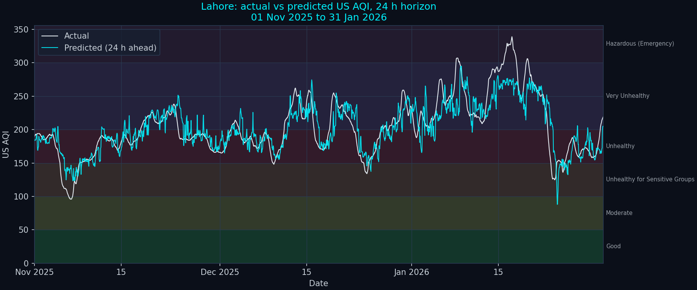
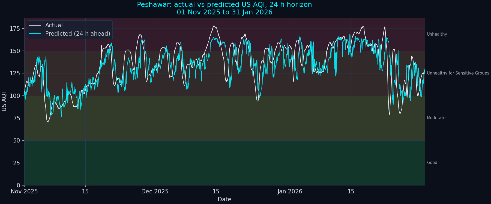
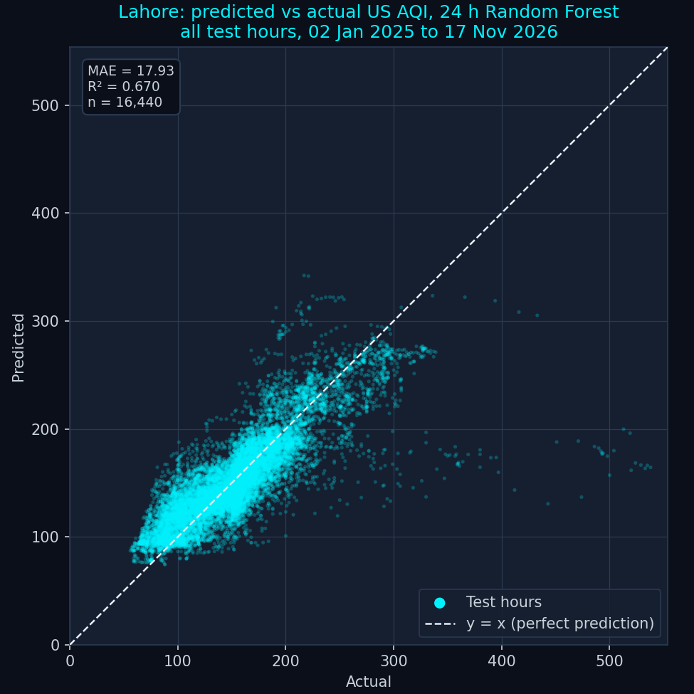
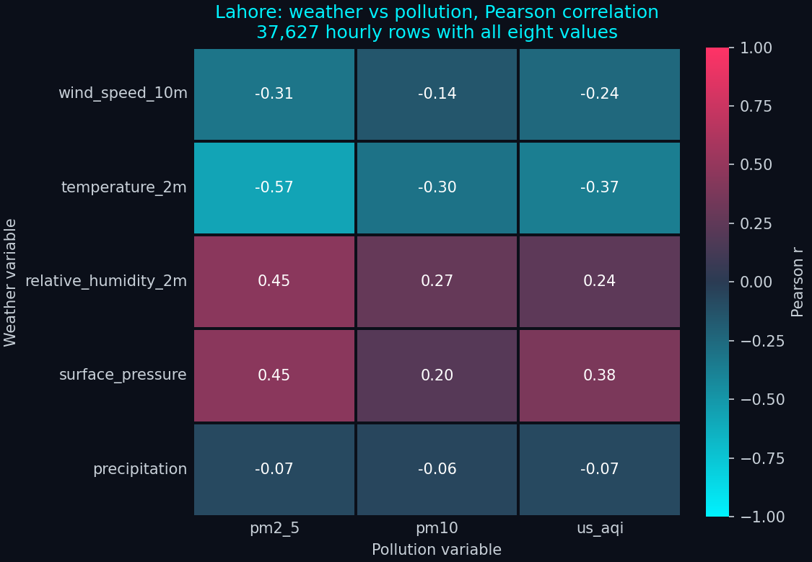
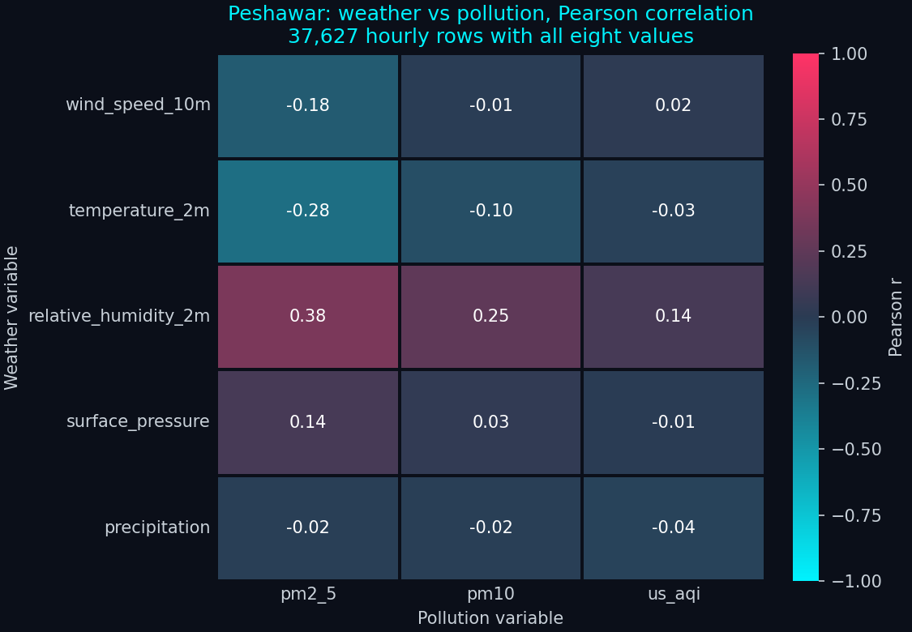
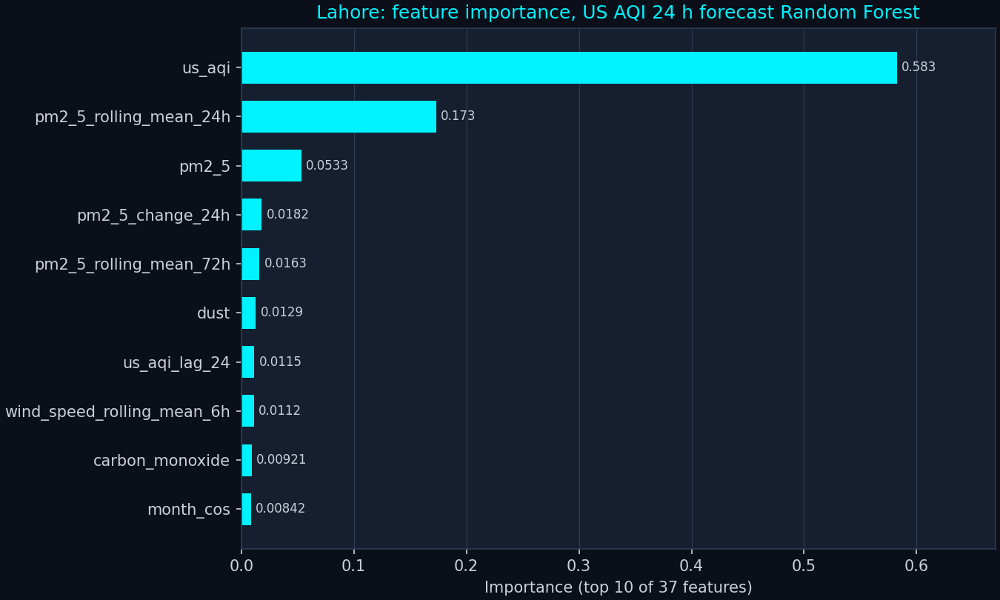
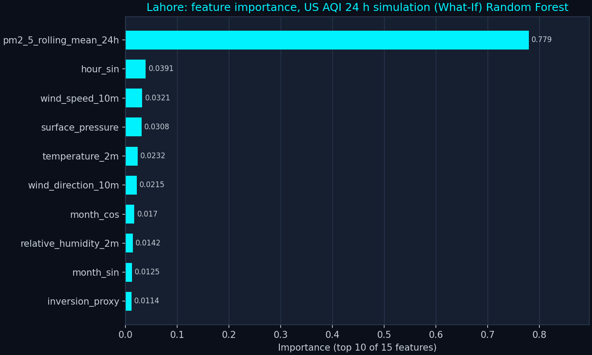
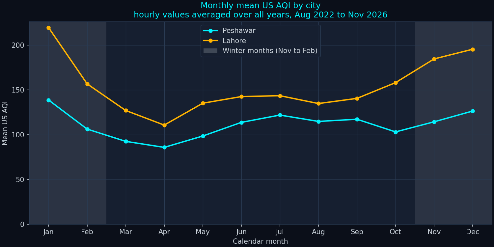

# Dhund-Khabar AI (دُھند خبر)

Dhund-Khabar AI forecasts winter smog in Lahore and Peshawar. It audits an hourly air-quality file for the two cities, builds features from past data only, trains Random Forest models for PM2.5 and US AQI at 24, 48 and 72 hours ahead, compares them with simple baselines on a strict time-based split, maps each predicted AQI to a US EPA tier with a fixed advisory text, and shows the results in a Streamlit dashboard with a What-If Simulation Lab.

> **Disclaimer:** this is a student learning project, not an official health warning system. Do not use it to make health or safety decisions.

## Contents

1. [Problem statement](#problem-statement)
2. [Objectives](#objectives)
3. [Dataset](#dataset)
4. [Methodology](#methodology)
5. [Results](#results)
6. [Discussion](#discussion)
7. [Limitations](#limitations)
8. [Future work](#future-work)
9. [How to run](#how-to-run)
10. [Project structure](#project-structure)

## Problem statement

Every winter, cold and still air over Punjab and Khyber Pakhtunkhwa traps pollution close to the ground. Lahore and Peshawar then see days of haze (*dhund*) and unhealthy air. In the data used here, the winter months (November, December, January, February) are the worst months of the year in both cities. January has the highest monthly mean PM2.5 and the highest monthly mean US AQI in both cities (Lahore: PM2.5 140.14, US AQI 219.57; Peshawar: PM2.5 54.53, US AQI 138.69). Schools, hospitals, and residents need warning one to three days ahead, not only the value for today.

The question of this project: **can a model trained on 2022 to 2024 hourly data forecast PM2.5 and US AQI 24, 48 and 72 hours ahead for 2025 to 2026, and does it do better than the simplest possible forecast ("tomorrow will be like now")?**

## Objectives

1. Audit the real dataset before modelling: gaps, missing values, impossible values, provenance, and forecast-like rows.
2. Build leakage-free features per city (lags, rolling statistics, weather and time features).
3. Train Random Forest models for PM2.5 and US AQI at 24, 48 and 72 hours ahead, and compare them honestly with persistence, Linear Regression, and Gradient Boosting baselines.
4. Evaluate on a time-based split, on the full test period and on the winter months only.
5. Convert predicted AQI to EPA tiers with advisories (school status, respiratory guidance, industrial curfew).
6. Provide a dashboard with a What-If Simulation Lab, and state clearly where the model works and where it does not.

## Dataset

**File:** `data/pakistan_smog_master_hourly.csv`. All numbers in this section come from the Phase 1 audit (`docs/data_audit.md`, audit run 2026-11-21 23:11:48) and `data/processed/audit_flags.json`.

| Item | Value |
|---|---|
| Rows | 75,456 |
| Columns | 26 |
| Rows per city | 37,728 (Peshawar), 37,728 (Lahore) |
| Date range (both cities) | 2022-08-01 00:00 to 2026-11-19 23:00 |
| Time step | 1 hour, complete grid: 0 duplicate timestamps, 0 hourly gaps, 37,728 rows = 37,728 expected rows per city |
| `datetime` vs `time` mismatches | 0 |

**Columns.** `city`, `latitude`, `longitude`, `time`, then pollutants `pm10`, `pm2_5`, `carbon_monoxide`, `nitrogen_dioxide`, `sulphur_dioxide`, `ozone`, `dust`, then `us_aqi`, then weather `temperature_2m`, `relative_humidity_2m`, `surface_pressure`, `wind_speed_10m`, `wind_direction_10m`, `precipitation`, then calendar columns `datetime`, `year`, `month`, `day`, `hour`, `day_of_week`, `is_weekend`, and `aqi_category`.

**Missing values (same in both cities).**

| Column group | Missing hours per city | Where |
|---|---|---|
| Pollutants (`pm10`, `pm2_5`, `carbon_monoxide`, `nitrogen_dioxide`, `sulphur_dioxide`, `ozone`, `dust`) | 77 | start of the series (leading gap) |
| `us_aqi` | 101 | start of the series (leading gap) |
| Weather columns | 0 | none |

The first non-missing `pm2_5` is at 2022-08-04 05:00 and the first non-missing `us_aqi` is at 2022-08-05 05:00, exactly 24 hours later in both cities. This 24-hour offset is what you would expect if `us_aqi` uses a 24-hour average of PM2.5, but the audit did not prove that.

**Impossible values.** Negative concentrations exist in `nitrogen_dioxide` (Peshawar 2, Lahore 0) and `ozone` (Peshawar 22, Lahore 37). No negative PM, carbon monoxide, sulphur dioxide, or dust values, no `relative_humidity_2m` above 100, and no negative `us_aqi`. The pipeline clips these negative values to 0 (61 values: nitrogen_dioxide 2, ozone 59).

**us_aqi above 500.** 9 rows have `us_aqi` above 500, all in Lahore. The maximum is 538 (Lahore, 2025-05-23 04:00). The EPA scale ends at 500. These rows are kept and mapped to Hazardous (Emergency). The maximum in Peshawar is 228.

**Winter pattern in the data.** For `pm2_5` in both cities, the three highest monthly means are months 1, 12 and 11. For Lahore `us_aqi` the top three are also 1, 12 and 11. For Peshawar `us_aqi` the top three are months 1, 12 and 7, so 2 of 3 are winter months.

### Provenance: not confirmed

**It is unconfirmed whether this data comes from ground sensors or from a model or reanalysis product.** The audit could not decide this, and the student must confirm the source. Observation, not a fact: the column names (`pm10`, `pm2_5`, `carbon_monoxide`, `nitrogen_dioxide`, `sulphur_dioxide`, `ozone`, `dust`, `us_aqi`, `temperature_2m`, `relative_humidity_2m`, `wind_speed_10m`, ...) look like the variable names of the Open-Meteo Air Quality API, which serves CAMS model output. If that is the source, the values are model estimates and not sensor readings, and every conclusion below is about those estimates. Treat the results accordingly.

Two audit findings are consistent with `us_aqi` not being a plain PM2.5 index:

- The audit computed the EPA PM2.5 sub-index from the trailing 24-hour mean of `pm2_5` on a sample of 5,000 rows (`random_state=42`, from 75,254 rows that have both values). After rounding, the sub-index differed from `us_aqi` in **73.18 %** of rows with the 2024 EPA breakpoint table and in **84.76 %** with the 2012 table. A mismatch is expected, because `us_aqi` may be the maximum of several pollutant sub-indices (PM2.5, PM10, ozone, nitrogen dioxide, sulphur dioxide, carbon monoxide). It is not by itself a data error. In the 2024 table, `us_aqi` was below the PM2.5 sub-index in 43.14 % of sampled rows, which a "maximum of sub-indices" rule does not explain. The exact `us_aqi` formula is unknown.
- `aqi_category` is "Unknown" where `us_aqi` is missing. It is never used as a feature.

### Forecast-like rows

The audit checked for rows that look like model forecasts instead of observations (timestamps after the audit run time, and weekly repeated-value and decimal-precision checks over the last 180 days). **It flagged no rows**: `forecast_like_start` is `null` in `data/processed/audit_flags.json`, with 0 of 27 weeks flagged in each city. Separately, 2 rows per city have timestamps after the file's last-modified time (2026-11-19 21:18:50). They are kept and listed under limitations.

### Cleaning (approved Gap_Strategy)

Applied in `src/pipeline.py`. The real counts from the pipeline run:

| Step | Count |
|---|---|
| Duplicate (city, datetime) rows dropped | 0 |
| Rows inserted by hourly reindexing | 0 |
| Negative pollutant values clipped to 0 | 61 (nitrogen_dioxide 2, ozone 59) |
| Values forward-filled (interior gaps of at most 3 hours) | 0 |

The leading gap is left as missing. Those rows drop out of the model data. No rows are removed for being forecast-like. `us_aqi` values above 500 are kept.

## Methodology

### Processed data sizes

| File | Shape |
|---|---|
| `data/processed/features_all.csv` | 75,456 rows x 49 columns |
| `data/processed/model_dataset.csv` | 75,158 rows x 55 columns |

`model_dataset.csv` has 298 rows fewer than `features_all.csv`: 149 rows per city have a missing future target (77 leading rows plus the last 72 hours, which have no value 72 hours ahead). Each city then loses another 71 warm-up rows at the start, because the longest rolling window (72 hours) is not full yet. The warm-up rows are removed when the train/test split is made.

### Feature groups

All features are computed **per city** from values at or before the current hour. Rolling windows are trailing windows that end at the current row, so no feature looks into the future.

| Group | Columns | Count |
|---|---|---|
| Pollutants at time t | `pm2_5`, `pm10`, `carbon_monoxide`, `nitrogen_dioxide`, `sulphur_dioxide`, `ozone`, `dust` | 7 |
| PM2.5 lags | `pm2_5_lag_1`, `_3`, `_6`, `_12`, `_24`, `_48` (hours) | 6 |
| PM2.5 rolling and change | `pm2_5_rolling_mean_24h`, `pm2_5_rolling_mean_72h`, `pm2_5_rolling_std_24h`, `pm2_5_change_24h` (pm2_5 now minus pm2_5 24 h ago) | 4 |
| Weather at time t | `temperature_2m`, `relative_humidity_2m`, `surface_pressure`, `wind_speed_10m`, `wind_direction_10m`, `precipitation` | 6 |
| Weather rolling means (6 h) | `wind_speed_rolling_mean_6h`, `humidity_rolling_mean_6h`, `temperature_rolling_mean_6h` | 3 |
| Derived weather | `stagnation_flag`, `inversion_proxy` | 2 |
| Time | `hour_sin`, `hour_cos`, `month_sin`, `month_cos`, `is_weekend`, `is_winter` | 6 |
| US AQI (AQI models only) | `us_aqi` at time t, `us_aqi_lag_1`, `us_aqi_lag_24` | 3 |

- **Cyclical time.** `hour_sin` and `hour_cos` are sin and cos of 2π·hour/24. `month_sin` and `month_cos` are sin and cos of 2π·month/12. This lets the model see that hour 23 is next to hour 0. `is_winter` is 1 for months 11, 12, 1, 2.
- **Stagnation.** `stagnation_flag` is 1 when `wind_speed_10m` is below 5 km/h, else 0. Weak wind lets local smoke and dust build up.
- **Inversion proxy.** A thermal inversion (a warm layer of air over cold surface air) traps smog, but the dataset has no measurement of it. The project uses this heuristic instead:

  ```
  inversion_proxy = relative_humidity_2m / 100 - temperature_2m / 40
  ```

  It rises as the air gets colder and more humid. Levels: **Strong** if the proxy is >= 0.50, **Moderate** if >= 0.25, otherwise **Weak**. Example: 8 °C and 90 % humidity give 0.70 (Strong); 20 °C and 60 % give 0.10 (Weak). The formula and the two thresholds are fixed heuristics chosen for this project. They are not measured physics and have not been validated against real inversion data.

### Forecast mode and simulation mode

| Mode | Used for | Features |
|---|---|---|
| Forecast | The forecasts shown on the dashboard | PM2.5 models: **34** features. US AQI models: **37** features (the 34 plus `us_aqi`, `us_aqi_lag_1`, `us_aqi_lag_24`) |
| Simulation | The What-If Simulation Lab | **15** features: `pm2_5_rolling_mean_24h` as the only pollution feature, the 6 weather columns, `stagnation_flag`, `inversion_proxy`, and the 6 time features |

The Forecast mode relies heavily on current pollution and lags, so it may react weakly when a weather slider is moved. The Simulation mode has no hour-by-hour pollution lags, so weather inputs have more room to matter. One Simulation model per city is trained, for US AQI at 24 hours. Its slider response is statistical, not physical.

### Why US AQI models use `us_aqi` and PM2.5 models do not

- **US AQI forecast models** use `us_aqi` at time t and its lags at 1 and 24 hours. These values are known at prediction time, so this is not leakage. They are the most direct information about the quantity being predicted.
- **PM2.5 models never use `us_aqi` or `aqi_category`.** `us_aqi` is built partly from PM2.5, so giving it to a PM2.5 model would hand over a rewritten version of the answer. `aqi_category` is never used by any model.

### Time-based split with embargo

- **Training period:** 2022-08-01 to 2024-12-31 23:00.
- **Test period:** 2025-01-01 00:00 to the end of the data (2026-11-19 23:00). Rows are scored only if their target exists, so the last scored feature row is 2026-11-16 23:00 (the last 72 hours have no 72-hour-ahead value).
- **Embargo:** for a horizon of h hours, a training row at time t is kept only if t + h is before 2025-01-01. A row at 2024-12-31 20:00 with a 24-hour target would learn a value from 2025-01-01 20:00, which belongs to the test period. Dropping these rows means **every training label is a 2024 value or earlier**.

Real output of `python -m src.pipeline`. The numbers are identical for Peshawar and Lahore:

| Horizon | Training rows | Test rows | Last training feature row | Last training label | First test row | Rows dropped by embargo (per city) |
|---|---|---|---|---|---|---|
| 24 h | 21,044 | 16,440 | 2024-12-30 23:00 | 2024-12-31 23:00 | 2025-01-01 00:00 | 24 |
| 48 h | 21,020 | 16,440 | 2024-12-29 23:00 | 2024-12-31 23:00 | 2025-01-01 00:00 | 48 |
| 72 h | 20,996 | 16,440 | 2024-12-28 23:00 | 2024-12-31 23:00 | 2025-01-01 00:00 | 72 |

Training and test row counts are per city. Of the 16,440 test rows per city, 4,680 are in the winter months (November, December, January, February); the winter-only metrics use those rows.

The pipeline asserts that the last training timestamp is before the first test timestamp, and that the last training timestamp plus h hours is before 2025-01-01.

### Why random train/test splits and k-fold cross-validation are wrong here

Hourly air quality changes slowly. The PM2.5 value at 14:00 is almost the same as at 13:00 and 15:00. This is called autocorrelation. If the rows are shuffled into random folds, the hours right next to a test hour end up in the training set. The model then only has to copy its neighbours, which is easy, and the score looks far better than it would on truly new days. A random split also lets the model learn from the future: it can train on Tuesday and be tested on Monday. A forecast in real life never has that information. So a random split shows information from the future, and it inflates the scores. This project always trains on the past and tests on the later period, with an embargo at the boundary. It uses no random split and no k-fold.

### Models and baselines

| Name | Description |
|---|---|
| **Persistence (baseline)** | The forecast for time t+h is the value at time t. In words: "tomorrow will be like now". It needs no training. Any trained model should beat it, otherwise it adds nothing. |
| **Linear Regression** | `LinearRegression()` from scikit-learn. |
| **Gradient Boosting** | `GradientBoostingRegressor(random_state=42)`. |
| **Random Forest** | `RandomForestRegressor(n_estimators=100, max_depth=12, n_jobs=-1, random_state=42)`. The dashboard's default forecast model. |
| XGBoost (optional) | Trained only if the `xgboost` package is installed. It is not installed on the development machine, so it was skipped. |

Every model is evaluated with MAE, RMSE and R², on the full test period and on the winter months only. US AQI models also get tier accuracy and the recall and precision of detecting an Unhealthy-or-worse hour (AQI above 150).

**Why Random Forest is the default even though it is not the lowest-error model.** In the measured results (`results/metrics.csv`, forecast mode, 2 cities x 2 targets x 3 horizons x 2 subsets = 24 comparisons), Linear Regression or Gradient Boosting had a lower MAE than Random Forest in **all 24** comparisons. The project still keeps Random Forest as the dashboard's default, as specified at the start. Random Forest beat persistence on MAE in all 24 of those comparisons. The full tables and the discussion are in the Results and Discussion sections below.

### EPA alert system

Predicted AQI is mapped to one of six US EPA tiers by `src/alerts.py`.

| Tier | AQI range | Colour |
|---|---|---|
| Good | 0 to 50 | `#00E400` |
| Moderate | 51 to 100 | `#FFFF00` |
| Unhealthy for Sensitive Groups | 101 to 150 | `#FF7E00` |
| Unhealthy | 151 to 200 | `#FF0000` |
| Very Unhealthy | 201 to 300 | `#8F3F97` |
| Hazardous (Emergency) | 301 and above | `#7E0023` |

**Decimal boundary rule.** Predictions are decimals, so each tier includes its upper bound and a value between two listed ranges goes to the higher tier: `lower < AQI <= upper`, with Good starting at 0 inclusive. So 50 is Good, 50.4 is Moderate, 200 is Unhealthy, and 200.5 is Very Unhealthy. A value above 500, which the EPA scale does not define (the data reaches 538), is mapped to Hazardous (Emergency). A negative or NaN AQI raises an error.

**Advisory fields.** Each AQI gives a dictionary with the tier, the colour, a fixed warning text, a school status, respiratory guidance, and an industrial advisory:

| AQI | School status |
|---|---|
| up to 100 | Normal |
| above 100 up to 300 | Outdoor Restrictions |
| above 300 | Closure Recommended |

**Curfew rule.** When AQI is above 200 (exactly the Very Unhealthy and Hazardous (Emergency) tiers), the industrial advisory is "Brick Kiln & Heavy Vehicle Curfew Required". At 200 or below it says no curfew is required. The advisory texts are fixed project rules, not official government guidance.

## Results

All numbers in this section are read from `results/metrics.csv` and `results/sensitivity.csv` by a script, not typed by hand. MAE and RMSE are rounded to 2 decimals. R², tier accuracy, recall and precision are rounded to 3 decimals.

**Setup.**

- Models were trained on 2022-08-04 to 2024-12-31, with the embargo described in Methodology.
- The test period starts on 2025-01-01. The last scored row is 2026-11-16 23:00, because later rows have no 72-hour-ahead value.
- That gives 16,440 scored rows per city. Of these, 4,680 per city are in the winter months (November to February). "Winter" in the tables means only those rows.
- Scores come from the 24-hour, 48-hour and 72-hour forecast models in forecast mode, plus the simulation model for US AQI at 24 hours.

**Metrics in plain words.**

- **MAE** (mean absolute error) is the average size of the miss, in the unit of the target (PM2.5 in µg/m³, US AQI in AQI points). Lower is better.
- **RMSE** (root mean squared error) is like MAE, but big misses count more. If RMSE is much larger than MAE, a few large errors dominate.
- **R²** says how much better the model is than always guessing the test-period average. 1 is perfect, 0 is no better than the average, and a negative value is worse than the average.
- **Persistence** is the baseline "tomorrow will be like now": the forecast for t+h is the value at t. A trained model is only useful if it beats it.
- **Tier accuracy** is the share of hours where the predicted EPA tier equals the actual tier.
- **Unhealthy-or-worse** means US AQI above 150. **Recall** is the share of actual Unhealthy-or-worse hours that the model also flagged (missed alarms lower it). **Precision** is the share of flagged hours that really were Unhealthy-or-worse (false alarms lower it).

In every table the lowest MAE in each city/target/horizon group is in **bold**. Where two models tie at 2 decimals, only the first is bold (Peshawar us_aqi 48 h full test: Linear Regression and Gradient Boosting are both 17.23).

### Table 1: MAE, RMSE and R² on the full test period

| City | Target | Horizon | Model | MAE | RMSE | R2 |
|---|---|---|---|---|---|---|
| Peshawar | pm2_5 | 24 h | Persistence | 10.94 | 15.60 | 0.499 |
| Peshawar | pm2_5 | 24 h | Linear Regression | **9.98** | 13.45 | 0.627 |
| Peshawar | pm2_5 | 24 h | Gradient Boosting | 10.07 | 13.72 | 0.612 |
| Peshawar | pm2_5 | 24 h | Random Forest | 10.16 | 13.89 | 0.603 |
| Peshawar | pm2_5 | 48 h | Persistence | 12.54 | 16.98 | 0.406 |
| Peshawar | pm2_5 | 48 h | Linear Regression | **11.08** | 14.42 | 0.572 |
| Peshawar | pm2_5 | 48 h | Gradient Boosting | 11.10 | 14.64 | 0.559 |
| Peshawar | pm2_5 | 48 h | Random Forest | 11.36 | 14.86 | 0.545 |
| Peshawar | pm2_5 | 72 h | Persistence | 13.44 | 18.10 | 0.323 |
| Peshawar | pm2_5 | 72 h | Linear Regression | **11.43** | 14.94 | 0.539 |
| Peshawar | pm2_5 | 72 h | Gradient Boosting | 11.54 | 15.30 | 0.516 |
| Peshawar | pm2_5 | 72 h | Random Forest | 11.79 | 15.47 | 0.505 |
| Peshawar | us_aqi | 24 h | Persistence | 15.18 | 20.31 | 0.515 |
| Peshawar | us_aqi | 24 h | Linear Regression | 13.34 | 17.36 | 0.646 |
| Peshawar | us_aqi | 24 h | Gradient Boosting | **13.22** | 17.26 | 0.650 |
| Peshawar | us_aqi | 24 h | Random Forest | 13.61 | 17.70 | 0.632 |
| Peshawar | us_aqi | 48 h | Persistence | 19.15 | 25.18 | 0.253 |
| Peshawar | us_aqi | 48 h | Linear Regression | **17.23** | 21.82 | 0.439 |
| Peshawar | us_aqi | 48 h | Gradient Boosting | 17.23 | 21.81 | 0.440 |
| Peshawar | us_aqi | 48 h | Random Forest | 17.82 | 22.52 | 0.403 |
| Peshawar | us_aqi | 72 h | Persistence | 20.93 | 27.47 | 0.110 |
| Peshawar | us_aqi | 72 h | Linear Regression | **18.13** | 23.04 | 0.374 |
| Peshawar | us_aqi | 72 h | Gradient Boosting | 18.25 | 23.30 | 0.359 |
| Peshawar | us_aqi | 72 h | Random Forest | 18.90 | 24.02 | 0.319 |
| Lahore | pm2_5 | 24 h | Persistence | 20.71 | 30.71 | 0.584 |
| Lahore | pm2_5 | 24 h | Linear Regression | **19.08** | 27.49 | 0.667 |
| Lahore | pm2_5 | 24 h | Gradient Boosting | 19.38 | 28.17 | 0.650 |
| Lahore | pm2_5 | 24 h | Random Forest | 19.99 | 29.34 | 0.620 |
| Lahore | pm2_5 | 48 h | Persistence | 25.96 | 37.97 | 0.355 |
| Lahore | pm2_5 | 48 h | Linear Regression | **22.35** | 31.83 | 0.547 |
| Lahore | pm2_5 | 48 h | Gradient Boosting | 22.56 | 32.31 | 0.533 |
| Lahore | pm2_5 | 48 h | Random Forest | 23.05 | 33.05 | 0.512 |
| Lahore | pm2_5 | 72 h | Persistence | 28.38 | 40.74 | 0.246 |
| Lahore | pm2_5 | 72 h | Linear Regression | **23.55** | 33.32 | 0.496 |
| Lahore | pm2_5 | 72 h | Gradient Boosting | 23.61 | 33.20 | 0.500 |
| Lahore | pm2_5 | 72 h | Random Forest | 24.37 | 34.75 | 0.452 |
| Lahore | us_aqi | 24 h | Persistence | 21.10 | 33.60 | 0.499 |
| Lahore | us_aqi | 24 h | Linear Regression | 17.59 | 26.77 | 0.682 |
| Lahore | us_aqi | 24 h | Gradient Boosting | **17.28** | 26.26 | 0.694 |
| Lahore | us_aqi | 24 h | Random Forest | 17.93 | 27.29 | 0.670 |
| Lahore | us_aqi | 48 h | Persistence | 28.26 | 42.65 | 0.186 |
| Lahore | us_aqi | 48 h | Linear Regression | 24.37 | 35.28 | 0.443 |
| Lahore | us_aqi | 48 h | Gradient Boosting | **24.16** | 34.67 | 0.462 |
| Lahore | us_aqi | 48 h | Random Forest | 25.02 | 35.83 | 0.425 |
| Lahore | us_aqi | 72 h | Persistence | 31.38 | 45.51 | 0.063 |
| Lahore | us_aqi | 72 h | Linear Regression | **26.67** | 37.53 | 0.363 |
| Lahore | us_aqi | 72 h | Gradient Boosting | 26.73 | 37.11 | 0.377 |
| Lahore | us_aqi | 72 h | Random Forest | 28.42 | 39.61 | 0.290 |

### Table 2: MAE, RMSE and R² on winter months only

| City | Target | Horizon | Model | MAE | RMSE | R2 |
|---|---|---|---|---|---|---|
| Peshawar | pm2_5 | 24 h | Persistence | 13.51 | 19.10 | 0.542 |
| Peshawar | pm2_5 | 24 h | Linear Regression | **12.06** | 16.18 | 0.671 |
| Peshawar | pm2_5 | 24 h | Gradient Boosting | 12.36 | 16.76 | 0.647 |
| Peshawar | pm2_5 | 24 h | Random Forest | 12.15 | 16.64 | 0.653 |
| Peshawar | pm2_5 | 48 h | Persistence | 14.20 | 19.07 | 0.543 |
| Peshawar | pm2_5 | 48 h | Linear Regression | 12.79 | 16.43 | 0.661 |
| Peshawar | pm2_5 | 48 h | Gradient Boosting | **12.70** | 16.59 | 0.654 |
| Peshawar | pm2_5 | 48 h | Random Forest | 12.74 | 16.62 | 0.653 |
| Peshawar | pm2_5 | 72 h | Persistence | 15.67 | 21.01 | 0.444 |
| Peshawar | pm2_5 | 72 h | Linear Regression | **13.36** | 17.27 | 0.625 |
| Peshawar | pm2_5 | 72 h | Gradient Boosting | 13.39 | 17.62 | 0.609 |
| Peshawar | pm2_5 | 72 h | Random Forest | 13.46 | 17.56 | 0.612 |
| Peshawar | us_aqi | 24 h | Persistence | 16.53 | 21.65 | 0.323 |
| Peshawar | us_aqi | 24 h | Linear Regression | 13.80 | 17.53 | 0.556 |
| Peshawar | us_aqi | 24 h | Gradient Boosting | **13.70** | 17.62 | 0.552 |
| Peshawar | us_aqi | 24 h | Random Forest | 14.33 | 18.24 | 0.519 |
| Peshawar | us_aqi | 48 h | Persistence | 19.06 | 24.16 | 0.163 |
| Peshawar | us_aqi | 48 h | Linear Regression | 16.93 | 21.20 | 0.356 |
| Peshawar | us_aqi | 48 h | Gradient Boosting | **16.75** | 20.87 | 0.376 |
| Peshawar | us_aqi | 48 h | Random Forest | 17.44 | 21.83 | 0.316 |
| Peshawar | us_aqi | 72 h | Persistence | 21.03 | 26.77 | -0.014 |
| Peshawar | us_aqi | 72 h | Linear Regression | **17.24** | 21.65 | 0.337 |
| Peshawar | us_aqi | 72 h | Gradient Boosting | 17.29 | 21.73 | 0.332 |
| Peshawar | us_aqi | 72 h | Random Forest | 17.90 | 22.20 | 0.303 |
| Lahore | pm2_5 | 24 h | Persistence | 30.84 | 43.00 | 0.516 |
| Lahore | pm2_5 | 24 h | Linear Regression | **28.64** | 38.57 | 0.611 |
| Lahore | pm2_5 | 24 h | Gradient Boosting | 28.91 | 39.82 | 0.585 |
| Lahore | pm2_5 | 24 h | Random Forest | 30.58 | 41.63 | 0.546 |
| Lahore | pm2_5 | 48 h | Persistence | 40.53 | 55.10 | 0.199 |
| Lahore | pm2_5 | 48 h | Linear Regression | **34.26** | 45.15 | 0.462 |
| Lahore | pm2_5 | 48 h | Gradient Boosting | 35.82 | 47.35 | 0.408 |
| Lahore | pm2_5 | 48 h | Random Forest | 36.92 | 48.43 | 0.381 |
| Lahore | pm2_5 | 72 h | Persistence | 45.54 | 60.08 | 0.038 |
| Lahore | pm2_5 | 72 h | Linear Regression | **36.91** | 47.73 | 0.393 |
| Lahore | pm2_5 | 72 h | Gradient Boosting | 38.27 | 48.99 | 0.360 |
| Lahore | pm2_5 | 72 h | Random Forest | 39.71 | 51.72 | 0.287 |
| Lahore | us_aqi | 24 h | Persistence | 22.07 | 29.37 | 0.584 |
| Lahore | us_aqi | 24 h | Linear Regression | **16.62** | 21.96 | 0.767 |
| Lahore | us_aqi | 24 h | Gradient Boosting | 17.10 | 22.63 | 0.753 |
| Lahore | us_aqi | 24 h | Random Forest | 18.83 | 25.40 | 0.689 |
| Lahore | us_aqi | 48 h | Persistence | 31.66 | 41.51 | 0.175 |
| Lahore | us_aqi | 48 h | Linear Regression | **25.51** | 33.51 | 0.463 |
| Lahore | us_aqi | 48 h | Gradient Boosting | 26.30 | 34.40 | 0.434 |
| Lahore | us_aqi | 48 h | Random Forest | 28.72 | 37.57 | 0.324 |
| Lahore | us_aqi | 72 h | Persistence | 37.08 | 46.92 | -0.054 |
| Lahore | us_aqi | 72 h | Linear Regression | **29.28** | 37.42 | 0.330 |
| Lahore | us_aqi | 72 h | Gradient Boosting | 30.81 | 39.29 | 0.261 |
| Lahore | us_aqi | 72 h | Random Forest | 33.81 | 43.84 | 0.080 |

### Table 3: US AQI tier accuracy and Unhealthy-or-worse recall and precision, full test period

| City | Horizon | Model | Tier accuracy | Unhealthy-or-worse recall | Unhealthy-or-worse precision |
|---|---|---|---|---|---|
| Peshawar | 24 h | Persistence | 0.683 | 0.587 | 0.581 |
| Peshawar | 24 h | Linear Regression | 0.720 | 0.430 | 0.763 |
| Peshawar | 24 h | Gradient Boosting | 0.718 | 0.441 | 0.751 |
| Peshawar | 24 h | Random Forest | 0.705 | 0.402 | 0.736 |
| Peshawar | 48 h | Persistence | 0.611 | 0.502 | 0.493 |
| Peshawar | 48 h | Linear Regression | 0.625 | 0.262 | 0.637 |
| Peshawar | 48 h | Gradient Boosting | 0.622 | 0.243 | 0.658 |
| Peshawar | 48 h | Random Forest | 0.613 | 0.264 | 0.639 |
| Peshawar | 72 h | Persistence | 0.576 | 0.438 | 0.430 |
| Peshawar | 72 h | Linear Regression | 0.610 | 0.183 | 0.596 |
| Peshawar | 72 h | Gradient Boosting | 0.609 | 0.195 | 0.622 |
| Peshawar | 72 h | Random Forest | 0.596 | 0.199 | 0.539 |
| Lahore | 24 h | Persistence | 0.633 | 0.826 | 0.824 |
| Lahore | 24 h | Linear Regression | 0.662 | 0.798 | 0.884 |
| Lahore | 24 h | Gradient Boosting | 0.670 | 0.795 | 0.895 |
| Lahore | 24 h | Random Forest | 0.664 | 0.796 | 0.890 |
| Lahore | 48 h | Persistence | 0.527 | 0.756 | 0.754 |
| Lahore | 48 h | Linear Regression | 0.536 | 0.657 | 0.837 |
| Lahore | 48 h | Gradient Boosting | 0.543 | 0.667 | 0.843 |
| Lahore | 48 h | Random Forest | 0.517 | 0.625 | 0.834 |
| Lahore | 72 h | Persistence | 0.493 | 0.734 | 0.732 |
| Lahore | 72 h | Linear Regression | 0.493 | 0.590 | 0.827 |
| Lahore | 72 h | Gradient Boosting | 0.502 | 0.621 | 0.835 |
| Lahore | 72 h | Random Forest | 0.480 | 0.606 | 0.799 |

### Table 4: the same, winter months only

| City | Horizon | Model | Tier accuracy | Unhealthy-or-worse recall | Unhealthy-or-worse precision |
|---|---|---|---|---|---|
| Peshawar | 24 h | Persistence | 0.605 | 0.582 | 0.570 |
| Peshawar | 24 h | Linear Regression | 0.681 | 0.470 | 0.814 |
| Peshawar | 24 h | Gradient Boosting | 0.674 | 0.458 | 0.783 |
| Peshawar | 24 h | Random Forest | 0.645 | 0.419 | 0.721 |
| Peshawar | 48 h | Persistence | 0.570 | 0.555 | 0.535 |
| Peshawar | 48 h | Linear Regression | 0.578 | 0.281 | 0.637 |
| Peshawar | 48 h | Gradient Boosting | 0.585 | 0.254 | 0.678 |
| Peshawar | 48 h | Random Forest | 0.580 | 0.334 | 0.642 |
| Peshawar | 72 h | Persistence | 0.506 | 0.480 | 0.461 |
| Peshawar | 72 h | Linear Regression | 0.572 | 0.195 | 0.666 |
| Peshawar | 72 h | Gradient Boosting | 0.583 | 0.239 | 0.676 |
| Peshawar | 72 h | Random Forest | 0.566 | 0.267 | 0.535 |
| Lahore | 24 h | Persistence | 0.676 | 0.936 | 0.920 |
| Lahore | 24 h | Linear Regression | 0.739 | 0.952 | 0.936 |
| Lahore | 24 h | Gradient Boosting | 0.739 | 0.952 | 0.939 |
| Lahore | 24 h | Random Forest | 0.727 | 0.952 | 0.940 |
| Lahore | 48 h | Persistence | 0.546 | 0.905 | 0.878 |
| Lahore | 48 h | Linear Regression | 0.613 | 0.952 | 0.886 |
| Lahore | 48 h | Gradient Boosting | 0.612 | 0.948 | 0.896 |
| Lahore | 48 h | Random Forest | 0.573 | 0.922 | 0.891 |
| Lahore | 72 h | Persistence | 0.475 | 0.892 | 0.855 |
| Lahore | 72 h | Linear Regression | 0.521 | 0.929 | 0.870 |
| Lahore | 72 h | Gradient Boosting | 0.540 | 0.938 | 0.878 |
| Lahore | 72 h | Random Forest | 0.488 | 0.944 | 0.859 |

### Table 5: Simulation model next to the forecast Random Forest and persistence (US AQI, 24 h)

These rows are the `mode = simulation` rows of `results/metrics.csv`.

| City | Subset | Model | MAE | RMSE | R2 | Tier accuracy | Recall | Precision |
|---|---|---|---|---|---|---|---|---|
| Peshawar | full test | Persistence | 15.18 | 20.31 | 0.515 | 0.683 | 0.587 | 0.581 |
| Peshawar | full test | Random Forest (forecast) | **13.61** | 17.70 | 0.632 | 0.705 | 0.402 | 0.736 |
| Peshawar | full test | Random Forest (simulation) | 15.75 | 20.53 | 0.505 | 0.663 | 0.280 | 0.608 |
| Peshawar | winter | Persistence | 16.53 | 21.65 | 0.323 | 0.605 | 0.582 | 0.570 |
| Peshawar | winter | Random Forest (forecast) | **14.33** | 18.24 | 0.519 | 0.645 | 0.419 | 0.721 |
| Peshawar | winter | Random Forest (simulation) | 15.94 | 19.93 | 0.426 | 0.613 | 0.281 | 0.694 |
| Lahore | full test | Persistence | 21.10 | 33.60 | 0.499 | 0.633 | 0.826 | 0.824 |
| Lahore | full test | Random Forest (forecast) | **17.93** | 27.29 | 0.670 | 0.664 | 0.796 | 0.890 |
| Lahore | full test | Random Forest (simulation) | 19.65 | 29.50 | 0.614 | 0.633 | 0.758 | 0.854 |
| Lahore | winter | Persistence | 22.07 | 29.37 | 0.584 | 0.676 | 0.936 | 0.920 |
| Lahore | winter | Random Forest (forecast) | **18.83** | 25.40 | 0.689 | 0.727 | 0.952 | 0.940 |
| Lahore | winter | Random Forest (simulation) | 20.38 | 26.52 | 0.661 | 0.703 | 0.970 | 0.913 |

### What the tables say

All counts below were computed from `results/metrics.csv` (forecast mode: 2 cities x 2 targets x 3 horizons x 2 subsets = 24 comparisons).

- **Random Forest vs persistence.** Random Forest had a lower MAE than persistence in **24 of 24** comparisons. The margin is small in some of them. The closest win is Lahore PM2.5, 24 h, winter: 30.58 vs 30.84, which is 0.8 % lower. The next closest is Lahore PM2.5, 24 h, full test: 19.99 vs 20.71 (3.5 %). The largest win is Lahore US AQI, 24 h, full test: 17.93 vs 21.10 (15.0 %).
- **Random Forest vs the simpler models.** Linear Regression or Gradient Boosting had a lower MAE than Random Forest in **24 of 24** comparisons (Linear Regression in 23, Gradient Boosting in 23). The gap between Random Forest and the best of the other two ranges from 0.3 % to 13.4 % of Random Forest's MAE, with a median of 3.6 %. The largest gap is Lahore US AQI, 72 h, winter (33.81 vs 29.28 for Linear Regression). Random Forest is the project's default model by decision, not because it scored best.
- **Cases where a Random Forest did not beat persistence on MAE.** Exactly one: the **Peshawar US AQI 24 h simulation model on the full test period** (15.75 vs persistence 15.18). The other three simulation rows beat persistence (Peshawar winter 15.94 vs 16.53, Lahore full 19.65 vs 21.10, Lahore winter 20.38 vs 22.07). The simulation model has a higher MAE than the forecast Random Forest in all 4 rows (for example 15.75 vs 13.61 for Peshawar, full test).
- **Cases where persistence caught more Unhealthy-or-worse hours than the model.** In 9 of the 12 forecast US AQI city/horizon/subset cases, persistence has a higher recall than Random Forest:
  - Peshawar, full test: 24 h 0.587 vs 0.402, 48 h 0.502 vs 0.264, 72 h 0.438 vs 0.199.
  - Peshawar, winter: 24 h 0.582 vs 0.419, 48 h 0.555 vs 0.334, 72 h 0.480 vs 0.267.
  - Lahore, full test: 24 h 0.826 vs 0.796, 48 h 0.756 vs 0.625, 72 h 0.734 vs 0.606.
  - In Lahore winter, Random Forest recall is higher than persistence at all three horizons. In all 12 cases, Random Forest precision is higher than persistence precision. So the model raises fewer false alarms but misses more real ones. The simulation model has lower recall than persistence in 3 of its 4 rows (all except Lahore winter, 0.970 vs 0.936).
- **72 h in winter.** Random Forest R² at 72 h on winter hours: Lahore US AQI **0.080**, Lahore PM2.5 0.287, Peshawar US AQI 0.303, Peshawar PM2.5 0.612. Persistence R² on winter US AQI at 72 h is negative in both cities (Peshawar -0.014, Lahore -0.054).
- **Which horizons work.** Random Forest R² for US AQI on the full test period falls from 0.632 (Peshawar) and 0.670 (Lahore) at 24 h to 0.403 and 0.425 at 48 h, and 0.319 and 0.290 at 72 h. From 24 h to 72 h, US AQI MAE grows by 38.8 % (Peshawar) and 58.5 % (Lahore) on the full test, and by 24.9 % and 79.6 % in winter. PM2.5 MAE grows less: 16.1 % and 21.9 % on the full test, 10.7 % and 29.9 % in winter. By these numbers, 24 h works clearly, 48 h works moderately, and 72 h is weak for US AQI, especially in Lahore in winter.

### Sensitivity of the What-If Simulation Lab (cold hours)

`results/sensitivity.csv` holds the test hours with `temperature_2m` <= 15 °C (Peshawar 3,607 rows, Lahore 2,442 rows). Each row is the average change in predicted 24 h US AQI when one input is changed and everything else is kept. Wind: +5 km/h. Humidity: +20 % (capped at 100 %). The expected direction is that more wind lowers AQI and more humidity raises it.

| City | Model | Change applied | Rows (cold hours <= 15 C) | Mean change in predicted AQI | Expected direction |
|---|---|---|---|---|---|
| Peshawar | simulation | wind +5 km/h | 3607 | -1.915 | yes |
| Peshawar | simulation | humidity +20 % | 3607 | +0.180 | yes |
| Peshawar | forecast | wind +5 km/h | 3607 | -0.128 | yes |
| Peshawar | forecast | humidity +20 % | 3607 | -0.018 | no |
| Lahore | simulation | wind +5 km/h | 2442 | -11.079 | yes |
| Lahore | simulation | humidity +20 % | 2442 | -0.086 | no |
| Lahore | forecast | wind +5 km/h | 2442 | -1.165 | yes |
| Lahore | forecast | humidity +20 % | 2442 | +0.095 | yes |

- **Wind** lowered the predicted AQI in **4 of 4** city/model cases.
- **Humidity** moved the prediction in the expected direction in only **2 of 4** cases (Peshawar simulation and Lahore forecast).
- Every humidity effect is tiny, at most 0.18 AQI points, so these signs are not evidence of a real humidity effect.
- The humidity change was capped at 100 %, so the mean applied change was smaller than +20: **+17.73** in Peshawar and **+12.36** in Lahore (from `results/train_log.txt`).
- The wind effect is far larger in the simulation models than in the forecast models: -1.915 vs -0.128 in Peshawar and -11.079 vs -1.165 in Lahore.

**Why the simulation model exists.** The forecast US AQI model leans on the current AQI. The top feature of the Random Forest (US AQI, 24 h) is `us_aqi` itself, with importance **0.698** in Peshawar and **0.583** in Lahore (loaded from `models/*.joblib`). After that:

- Peshawar: `pm2_5_change_24h` 0.045 and `pm2_5_rolling_mean_72h` 0.023.
- Lahore: `pm2_5_rolling_mean_24h` 0.173 and `pm2_5` 0.053.

When the current AQI dominates, changing a weather slider barely moves the forecast. The simulation model removes `us_aqi` and the hourly pollution lags, so weather gets more weight. Its top three features:

- Peshawar: `pm2_5_rolling_mean_24h` 0.549, `hour_sin` 0.120, `surface_pressure` 0.100.
- Lahore: `pm2_5_rolling_mean_24h` 0.779, `hour_sin` 0.039, `wind_speed_10m` 0.032.

The cost is accuracy: the simulation model's MAE is 1.55 to 2.14 AQI points higher than the forecast Random Forest. Its slider response is statistical, learned from past data. It is not a physical model of smog.

### Figures

All figures are in `results/figures/`.



*Lahore, 24 h forecast against the actual AQI for the winter of 2025/26.* The prediction follows the slow ups and downs, but it stays below the highest peaks (the actual line reaches about 340 in mid-January, the prediction stays near 275) and it reacts to a sharp drop about a day late.



*Peshawar, same window.* Peshawar AQI stays mostly between 100 and 180. The prediction follows the level but is noisy hour to hour, and it follows sharp changes with a delay.



*Lahore, every test hour, predicted against actual.* Points near the dashed diagonal are good predictions. The cloud is tight up to about 250 and lies below the diagonal at high values. For actual values above about 350, the predictions are roughly 130 to 200, so the most dangerous hours are the worst predicted. The title dates are target times (24 h after the feature row), so they end on 17 Nov 2026.





*Correlations between the features and the target, one heatmap per city.* They show which inputs move together with pollution. A correlation shows association only, not cause.



*Feature importance of the Lahore forecast Random Forest.* `us_aqi` carries 0.583 of the importance, so the model mostly extends the current AQI.



*Feature importance of the Lahore simulation model.* `pm2_5_rolling_mean_24h` carries 0.779, and each weather input is small (the largest, `wind_speed_10m`, is 0.032). Importance does not show the direction of an effect.



*Monthly mean US AQI of the two cities.* It shows the winter peak in both cities and that Lahore is much higher than Peshawar.

## Discussion

**Which horizons work.** 24 h is usable. Random Forest beats persistence by 10 to 15 % in MAE in all four 24 h US AQI groups (full test and winter, both cities), and R² is 0.52 to 0.69. 48 h is moderate (US AQI R² 0.32 to 0.43). 72 h is weak: US AQI R² is 0.29 to 0.32 on the full test and falls to 0.080 for Lahore in winter. PM2.5 holds up better at long horizons than US AQI, with 72 h R² between 0.287 and 0.612. Part of the reason may be that the US AQI models rely on the current AQI, which loses value as the horizon grows.

**Where the model fails.**

- *Peaks.* High values are under-predicted, as the Lahore scatter shows (hours above about 350 are predicted at 130 to 200, and the January 2026 peak of about 340 is predicted near 275). Tree-based models cannot predict above the values they saw in training and tend to average toward the middle. This is the likely cause, and it was not tested separately.
- *Low recall in Peshawar.* Random Forest finds only 0.402 of Unhealthy-or-worse hours at 24 h and 0.199 at 72 h (full test). Persistence finds more (0.587 and 0.438). Peshawar's AQI sits close to the 150 line, so small errors flip the label, and the model tends to stay on the safe side of it. That is a likely explanation, not a proven one.
- *Sharp drops.* The time-series plots show the prediction lagging behind sudden falls, which is what a model built from yesterday's values would do.
- *Lahore at 72 h in winter.* US AQI R² is 0.080, so the forecast adds almost nothing over the average at that range.

**Winter vs the full test period (Random Forest).** Winter MAE is higher than the full-test MAE in 10 of 12 cases. Lahore PM2.5 is the clearest: at 24 h it is 30.58 in winter against 19.99 on the full test (+10.59), and +15.33 at 72 h. The two exceptions are Peshawar US AQI at 48 h and 72 h (winter MAE 0.39 and 1.00 lower). R² is lower in winter in 8 of 12 cases. The biggest drop is Lahore US AQI at 72 h (0.290 to 0.080). Peshawar PM2.5 R² is higher in winter at all three horizons (+0.050, +0.107, +0.106). So winter, the season that matters most for smog, is not easier, and for Lahore it is harder.

**US AQI vs PM2.5 targets.** MAE values cannot be compared across the two targets because the units differ. By R² at 24 h, the US AQI model is better in 3 of 4 city/subset groups (the exception is Peshawar winter, 0.519 vs 0.653). At 72 h the PM2.5 model has the higher R² in all 4 groups. The US AQI models lose accuracy faster as the horizon grows.

**Why simple models do as well.** Hourly pollution is strongly autocorrelated, so the current value and its lags explain most of what can be predicted, and Linear Regression can use them nearly as well as a forest. Random Forest averages many trees into steps, which smooths its output and makes it weaker at extremes. These are likely reasons, not tested here. The data may also be a model estimate instead of sensor readings (see Dataset), which would make it smoother and easier for simple models.

**What this means for the default model.** Random Forest is the dashboard's default by decision. The measured results do not support it as the most accurate choice: Linear Regression or Gradient Boosting scored a lower MAE in all 24 comparisons, mostly by a few percent. Random Forest still beats persistence in all 24, so it is a valid forecaster, and the dashboard must not present it as the best available model. The simulation model is for exploring what-if inputs and not for forecasting: it loses to persistence in one case and its humidity response is not reliable.


## Limitations

### Tier counts and imbalance

The counts below come from applying `alerts.aqi_to_tier_index` to every non-NaN `us_aqi` value in `data/pakistan_smog_master_hourly.csv`, per city. Command (run from the project root):

```powershell
python -c "
import pandas as pd
from src import alerts
d = pd.read_csv('data/pakistan_smog_master_hourly.csv').dropna(subset=['us_aqi'])
d['t'] = d['us_aqi'].map(alerts.aqi_to_tier_index)
c = pd.crosstab(d['city'], d['t']); c.loc['All'] = c.sum()
print(c); print((c.div(c.sum(1), axis=0) * 100).round(2)); print(c.sum(1))
"
```

Printed output:

```
t           0      1      2      3     4    5
city                                         
Lahore     44   4810  11736  16223  4584  230
Peshawar   87  16593  15636   5172   139    0
All       131  21403  27372  21395  4723  230
t            0      1      2      3      4     5
city                                            
Lahore    0.12  12.78  31.19  43.12  12.18  0.61
Peshawar  0.23  44.10  41.56  13.75   0.37  0.00
All       0.17  28.44  36.37  28.43   6.28  0.31
city
Lahore      37627
Peshawar    37627
All         75254
```

| Tier (index) | Lahore | Lahore % | Peshawar | Peshawar % | All | All % |
|---|---|---|---|---|---|---|
| Good (0) | 44 | 0.12 | 87 | 0.23 | 131 | 0.17 |
| Moderate (1) | 4,810 | 12.78 | 16,593 | 44.10 | 21,403 | 28.44 |
| Unhealthy for Sensitive Groups (2) | 11,736 | 31.19 | 15,636 | 41.56 | 27,372 | 36.37 |
| Unhealthy (3) | 16,223 | 43.12 | 5,172 | 13.75 | 21,395 | 28.43 |
| Very Unhealthy (4) | 4,584 | 12.18 | 139 | 0.37 | 4,723 | 6.28 |
| Hazardous (Emergency) (5) | 230 | 0.61 | 0 | 0.00 | 230 | 0.31 |
| Total | 37,627 | 100 | 37,627 | 100 | 75,254 | 100 |

Good is almost never observed (0.17 % of hours) and Hazardous (Emergency) occurs only in Lahore. Peshawar has no Hazardous hours and only 139 Very Unhealthy hours in the whole file. Any tier metric for these rare tiers rests on very few hours and is noisy. This is why the tier results report Unhealthy-or-worse recall and precision instead of per-tier scores for every tier.

### Data

- **Provenance is not confirmed.** The values may be modelled or reanalysis data and not sensor readings. The column names resemble Open-Meteo / CAMS output. That is an observation, not a finding. The student must confirm the source before claiming the data are measurements (see Dataset).
- **`us_aqi` is not exactly the EPA formula applied to the PM2.5 column.** On a sample of 5,000 rows, 73.18 % did not match the 2024 PM2.5 table. `us_aqi` appears to start 24 hours after PM2.5, which suggests a 24-hour average, and it may include other pollutants. The models therefore predict the file's `us_aqi`, not an EPA index computed here.
- **Missing drivers.** The data contain no emissions, stubble-burning (crop residue), brick kiln, traffic or industrial data. The model sees only weather and past pollution, so it cannot anticipate a change in sources.
- **Two cities only.** Lahore and Peshawar. Nothing here shows the models work in other cities.
- **Leading_Gap.** The first 77 of 101 leading hours with missing values were dropped (Gap_Strategy, see Cleaning). The earliest part of the record is not used.
- **AQI above 500.** 9 rows (all Lahore, maximum 538) exceed the EPA scale. They are mapped to Hazardous (Emergency) and not removed.
- **Forecast_Like_Rows are unresolved.** The audit flagged none. Two rows per city after the file's last-modified time were kept, and they may have been forecasts when the file was saved. This could not be settled from the file.

### Models and evaluation

- **Skill drops with horizon.** Moving from 24 h to 72 h, US AQI R² falls and MAE rises in every group (see Discussion). At 72 h the Lahore winter US AQI R² is 0.080.
- **Peaks and extremes are under-predicted.** Unhealthy-or-worse recall is low in Peshawar (0.402 at 24 h and 0.199 at 72 h on the full test). The model must not be relied on for emergencies.
- **Random Forest is not the most accurate model.** It is the default by decision. Linear Regression or Gradient Boosting had a lower MAE in 24 of 24 comparisons, mostly by a few percent.
- **The What-If sliders are statistical, not physical.** They show how a trained model's output changes when inputs change, which reflects associations in this data. They are not a simulation of the atmosphere. The humidity sensitivity is near zero and has the wrong sign in 2 of 4 cases.
- **The inversion proxy is a heuristic.** It is built from available weather columns, not from a measured inversion or boundary-layer height.
- **One split, short test period.** The test period covers about 22 months (2025-01-01 to 2026-11-16) with a single train/test split. No rolling-origin validation was done.
- **Historical data, not live.** The dashboard's last data point is 2026-11-19 23:00. It is a replay of the file and not a live feed.
- **Tests use synthetic data only.** The test suite checks the code, not the real-data results. The DeprecationWarning messages from joblib and NumPy 2.5 seen during `pytest` come from library deprecations and are harmless.
- **Not a health warning system.** This is a student project. Do not use it to make health decisions. Official advisories come from the relevant authorities.

## Future work

- Confirm the data provenance and compare with ground monitors, for example a PM2.5 sensor network in Lahore and Peshawar.
- Add emissions, fire (stubble burning), traffic and boundary-layer-height data.
- Add more cities.
- Try quantile or probabilistic forecasts, or classify tiers directly with class weights, to improve recall of severe events.
- Use walk-forward (rolling-origin) validation instead of one split.
- Measure feature importance with permutation importance.
- Compare against XGBoost and LightGBM.
- Compute an EPA index from PM2.5 with the 2024 formula, and add PM10 and other pollutants.

## How to run

Run these in PowerShell from the project root. The path contains spaces, so quote it:

```powershell
cd "d:\5th sem\prog ai lab\dhund khabar ai"
```

The project was run with the global Python 3.14.3 and no virtual environment. Use the `python -m` forms below, which work with the global interpreter.

| Step | Command | What it does and writes |
|---|---|---|
| 1 | `python -m pip install -r requirements.txt` (same as `pip install -r requirements.txt`) | Installs the dependencies. |
| 2 | `python scripts/audit_data.py` | Audits the raw files. Writes `docs/data_audit.md` and `data/processed/audit_flags.json`. |
| 3 | `python -m src.pipeline` | Cleans the data and builds features. Writes `data/processed/features_all.csv` and `data/processed/model_dataset.csv`. |
| 4 | `python scripts/train_all.py` | Trains all models and writes `models/*.joblib` (38 files), `results/metrics.csv`, `results/sensitivity.csv`, `results/train_log.txt` and `results/figures/`. It took about 8 minutes (8.0 and 8.1 min in the logs). |
| 5 | `python scripts/train_all.py --figures-only` | Redraws the figures from existing models without retraining. |
| 6 | `python -m pytest` (same as `pytest`) | Runs the tests. The last run reported 166 passed in 116.58 s. |
| 7 | `python -m streamlit run app.py` (same as `streamlit run app.py` when the `streamlit` command is on PATH) | Starts the dashboard. |

The dashboard only loads existing files from `data/`, `models/` and `results/`. It never retrains. Run steps 2 to 4 first if those files are missing.

## Project structure

```
dhund khabar ai/
├── app.py                      Streamlit dashboard (loads files only, never retrains)
├── requirements.txt            Python dependencies
├── pytest.ini                  pytest settings
├── README.md                   This report
├── data/
│   ├── lahore_smog_hourly.csv              Raw hourly data, Lahore
│   ├── peshawar_smog_hourly.csv            Raw hourly data, Peshawar
│   ├── pakistan_smog_daily.csv             Raw daily data
│   ├── pakistan_smog_master_hourly.csv     Master hourly file for both cities (used by the pipeline)
│   └── processed/
│       ├── audit_flags.json                Flags written by the audit
│       ├── features_all.csv                Engineered features
│       └── model_dataset.csv               Final model dataset
├── docs/
│   ├── data_audit.md                       Audit report
│   └── stitch/                             Dashboard design files from Stitch
│       ├── design_system.md                Design system notes
│       ├── screen_prompt.md                Prompt used to generate the screen
│       ├── stitch_ids.json                 Stitch project and screen IDs
│       ├── dashboard.html / .png           First generated dashboard
│       ├── dashboard_original.html / .png  Original variant
│       ├── dashboard_alt_console.html / .png   Console-style alternative
│       ├── dashboard_alt_modern.html / .png    Modern alternative
│       ├── dashboard_approved.html / .png      Approved design
│       └── dashboard_*preview*.png         Preview crops (approved, original, overview, top)
├── models/                     38 trained .joblib files, 88 MB (forecast models per city, target,
│                               horizon and algorithm, plus the 2 simulation models)
├── results/
│   ├── metrics.csv             All test metrics
│   ├── sensitivity.csv         What-If sensitivity results
│   ├── train_log.txt           Training log
│   └── figures/                21 PNG figures (heatmaps, scatter, actual vs predicted,
│                               feature importance, city comparison)
├── scripts/
│   ├── audit_data.py           Data audit
│   └── train_all.py            Trains models, writes metrics and figures
├── src/
│   ├── alerts.py               EPA tiers and alert logic
│   ├── charts.py               Chart builders for the dashboard
│   ├── model.py                Model training and prediction helpers
│   ├── pipeline.py             Cleaning and feature engineering
│   └── utils.py                Shared helpers
└── tests/                      pytest suite on synthetic data
    ├── conftest.py             Shared fixtures
    ├── test_alerts.py
    ├── test_conftest_smoke.py
    ├── test_model.py
    ├── test_pipeline.py
    └── test_utils.py
```

### Git note

`.gitignore` excludes Python caches, `models/` (88 MB) and `data/processed/` (about 66 MB). Both folders are regenerated by the commands above, so after cloning run `python -m src.pipeline` and `python scripts/train_all.py` before `python -m streamlit run app.py`. They were committed in the first four commits, so those commits still contain them.
